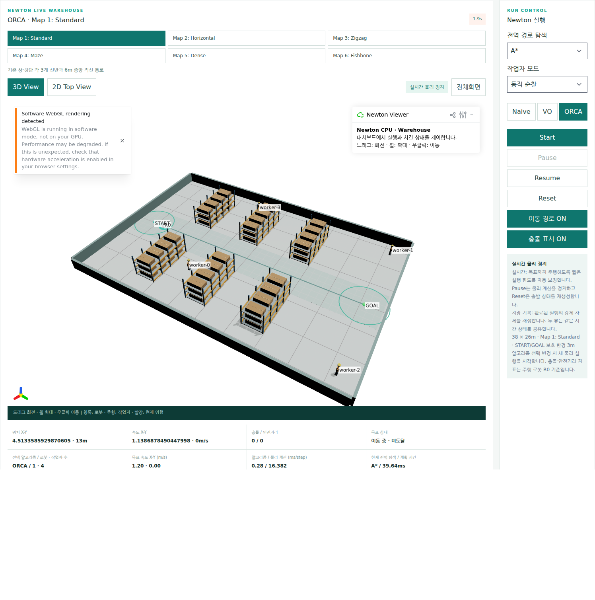
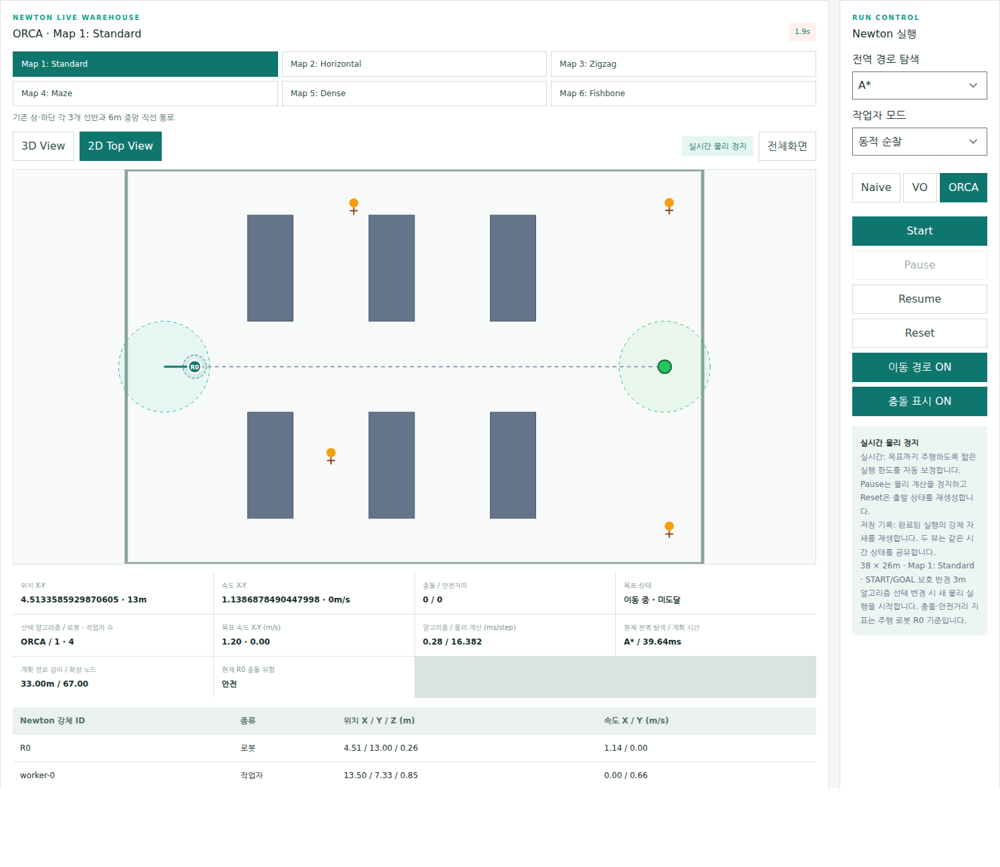
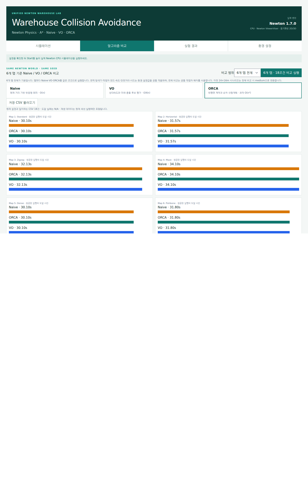
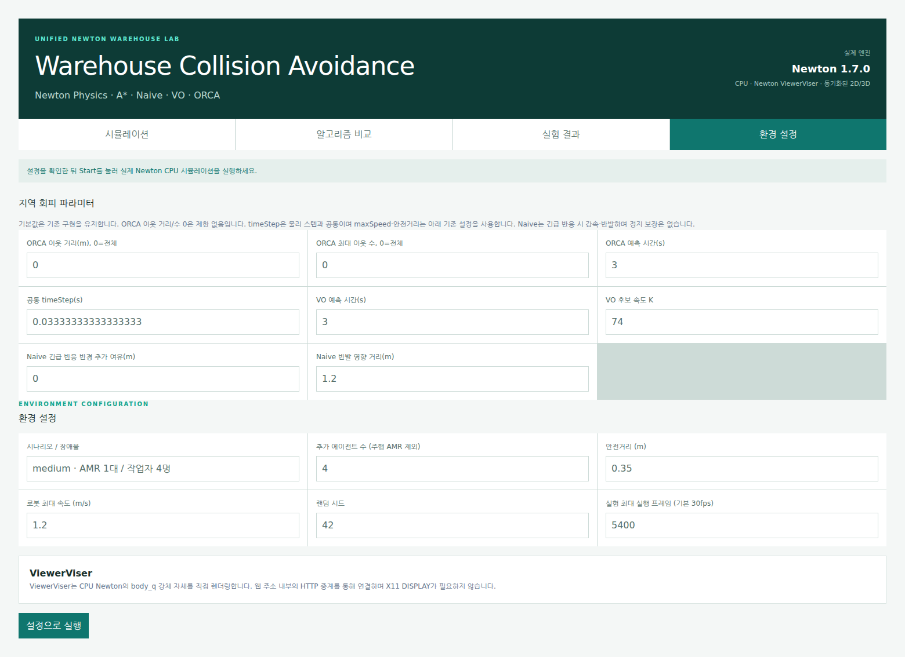
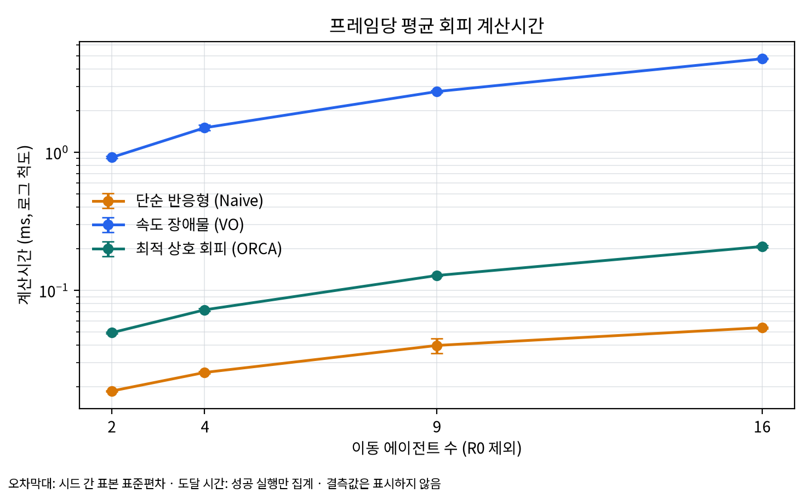

# 프로젝트 이름 : Warehouse Collision Avoidance — Newton 물류창고 충돌 회피 시뮬레이터

**사람과 이동 로봇이 함께 움직이는 물류창고에서 전역 경로 탐색과 지역 충돌 회피 알고리즘을 직접 구현하고, 실제 물리 시뮬레이션·CSV·그래프로 비교하는 프로젝트입니다.**

## 1. 프로젝트 이름과 소개

이 프로젝트는 로봇이 선반과 작업자를 피해 목적지에 도달하는 과정을 관찰하고, 알고리즘별 안전성·이동 효율·계산 비용을 같은 조건에서 비교하기 위해 만들었습니다. 화면에서 로봇이 움직이는 모습을 확인하는 것과 함께, 실행 결과를 수치로 저장하고 다시 분석할 수 있도록 구성했습니다.

핵심 구현은 Python 기반 **Newton 1.7.0 CPU 강체 시뮬레이션**입니다. 웹에서는 **WIZ·Angular 대시보드와 Viser 3D 뷰어**를 연결하여 같은 물리 상태를 3D와 2D로 확인합니다. 초기 타당성 검토에 사용한 Pygame 2D 구현과 예비 실험 자료도 보관합니다.

### 주요 기능

| 기능 | 설명 |
|---|---|
| 6종 창고 맵 | Standard, Horizontal, Zigzag, Maze, Dense, Fishbone 배치를 선택합니다. |
| 전역 경로 탐색 | A*, Dijkstra, RRT로 선반을 피하는 경로를 계산합니다. |
| 지역 충돌 회피 | Naive, VO, ORCA를 교체하여 이동 중 주변 에이전트에 대응합니다. |
| 실제 물리 주행 | Newton 강체의 위치·속도와 접촉 결과를 사용하고 힘 제어로 로봇을 움직입니다. |
| 3D·2D 동기화 | Viser 3D 화면과 2D Top View가 같은 Newton 상태를 표시합니다. |
| 실행 제어 | Start, Pause, Resume, Reset, 기록 슬라이더, 경로·위험 표시를 제공합니다. |
| 18조건 비교 | 6개 맵 × 3개 회피 알고리즘을 공통 작업자 배치로 실행합니다. |
| 결과 저장 | 도달시간·이동거리·충돌·안전거리 위반·계산시간을 CSV로 저장합니다. |
| 반복 실험 | 이동 에이전트 수 4단계 × 3개 알고리즘 × 5개 시드, 총 60회를 실행합니다. |
| 그래프·재현성 | CSV 기반 그래프 5종과 같은 조건의 반복 실행 결과 비교를 제공합니다. |

### 전역 탐색과 지역 회피의 역할

전역 탐색은 선반·벽을 고려해 출발점에서 목적지까지 갈 경로를 만듭니다. 지역 회피는 그 경로를 따라가는 동안 움직이는 작업자와 다른 로봇에 대응할 목표 속도를 계산합니다.

- **A***: 격자에서 실제 이동 비용과 목적지까지의 추정 비용을 함께 사용합니다.
- **Dijkstra**: 누적 이동 비용을 기준으로 경로를 탐색합니다.
- **RRT**: 공간에 표본을 생성해 트리를 확장합니다. 이 구현에서 최단 경로 최적성을 보장하지 않습니다.
- **Naive**: 현재 거리로 위험을 판단해 감속·반발 속도를 계산합니다.
- **VO**: 상대 위치·속도로 미래 충돌을 예측하고 후보 속도 중 안전한 속도를 선택합니다.
- **ORCA**: 속도 반평면 제약을 만들고 순차 2차원 선형계획으로 허용 속도를 구합니다.

ORCA는 프로젝트 내부 구현입니다. 외부 RVO2 라이브러리를 사용하지 않으며, 현재 작업자·추가 AMR은 상호 회피에 참여하지 않는 순찰 에이전트이므로 R0가 회피 책임을 전부 부담합니다.

## 2. 사용한 기술

| 구분 | 언어·도구 | 사용 목적 |
|---|---|---|
| 시뮬레이션·실험 | Python 3.12 | 알고리즘 구현, 물리 제어, 반복 실험과 결과 저장 |
| 물리 엔진 | Newton 1.7.0 | 바닥·벽·선반·이동체의 강체와 접촉 계산 |
| 물리 계산 기반 | NVIDIA Warp 1.19.0 | Newton 계산 실행. 이 프로젝트의 검증은 CPU에서 수행 |
| 웹 3D 뷰어 | Viser 1.1.1, 브라우저 WebGL | 강체 자세·창고 모델·경로·위험 상태 시각화 |
| 웹 애플리케이션 | WIZ, Angular, TypeScript | 페이지·API 연동, 실행 제어, 비교 표와 환경 설정 |
| 템플릿·스타일 | Pug, SCSS | 화면 구조와 반응형 대시보드 구성 |
| 수치 처리 | NumPy | 위치·속도·벡터 연산과 시뮬레이션 상태 처리 |
| 실험 분석 | Pandas, Matplotlib | CSV 집계, 평균·표준편차와 한국어 그래프 생성 |
| 초기 2D 실험 | pygame-ce | 독립 2D 창고 UI와 예비 실험 |
| 자동 검증 | pytest, Playwright, Chromium | 알고리즘·물리·저장 API·실제 브라우저 흐름 검사 |
| 버전 관리 | Git, GitHub | 소스·문서·실험 자료 관리 |
| 그래프 글꼴 | Noto Sans KR | 한국어 그래프 제목·축·범례. SIL OFL 라이선스 포함 |

Newton용 의존성과 Pygame용 의존성은 별도 파일로 관리합니다. 정확한 설치 범위는 [requirements-newton.txt](warehouse-collision-avoidance/requirements-newton.txt), [requirements.txt](warehouse-collision-avoidance/requirements.txt)를 확인하십시오. Playwright는 브라우저 검증을 실행할 때 추가 설치합니다.

### 기본 환경과 파라미터

- 창고: 38 × 26m, 기본 출발점 (2.5, 13), 목적지 (35.5, 13).
- 제어 로봇 R0: 반경 0.42m, 질량 14kg. 기본 최대 속도 1.2m/s.
- 기본 시간 간격: 1/30초. 5400프레임이면 최대 물리시간 180초입니다.
- 안전거리 여유: 0.35m. VO 예측 구간 3초, 후보 속도 기본 74개.
- ORCA 예측 구간: 3초. 이웃 거리·개수의 기본값 0은 전체 이웃 처리를 뜻합니다.
- Fishbone은 논문을 참고한 자체 배치이며, 원 논문의 창고를 그대로 재현한 모델은 아닙니다.

## 3. 실행 화면

아래 네 화면은 **2026-11-17에 현재 WIZ 페이지와 실제 Newton CPU 실행을 Chromium으로 열어 직접 캡처**한 이미지입니다. 화면용 가상 수치나 목업을 사용하지 않았습니다. 3D·2D 화면은 물리시간 1.9초에서 일시정지한 같은 실행입니다.

### Newton 3D 시뮬레이션



맵·전역 탐색기·지역 회피 알고리즘을 선택하고 실제 주행을 제어합니다. 마우스 드래그로 시점을 회전하고 휠로 확대할 수 있습니다. 청록색은 제어 로봇과 주행 경로, 주황색은 작업자, 빨간색은 현재 위험 표시입니다. 서버 환경의 캡처에서는 소프트웨어 WebGL 렌더링 안내가 나타납니다.

### 같은 실행의 2D Top View



3D와 별도 계산한 애니메이션이 아니라, 같은 Newton 강체 상태를 평면에 투영합니다. 위치·속도·충돌·안전거리와 목표 도달 상태를 함께 확인합니다.

### 알고리즘 비교와 저장 결과



6개 맵의 Naive·VO·ORCA 결과를 표와 그래프로 확인합니다. 캡처 과정에서 저장 CSV 18행과 맵별 그래프 6개가 표시되는 것을 검사했습니다. 저장 CSV는 요약 지표이므로 프레임 재생은 제공하지 않으며, 현재 세션에서 실행한 강체 기록의 재생과 구분합니다.

### 환경 설정



시드·실행 한도·안전거리·속도와 ORCA·VO·Naive 파라미터를 조정합니다. 회피 파라미터 입력 8개가 실제 표시되는 것을 확인했습니다.

### 실제 CSV로 생성한 분석 그래프



이 그래프는 기존에 실제 실행한 60회 스윕의 CSV를 읽어 생성했습니다. y축은 로그 척도이며 오차막대는 시드 간 표본 표준편차입니다. 위 네 화면의 새 캡처 시점에 60회 전체를 다시 실행한 결과는 아닙니다.

[도달시간](warehouse-collision-avoidance/results/newton/figs/01_arrival_time.png), [이동거리](warehouse-collision-avoidance/results/newton/figs/02_path_length.png), [충돌·안전거리 위반](warehouse-collision-avoidance/results/newton/figs/03_collision_safety.png), [성공률](warehouse-collision-avoidance/results/newton/figs/04_success_rate.png) 그래프와 [실측 결과 설명](warehouse-collision-avoidance/docs/newton_result_summary.md)도 함께 제공합니다.

## 4. 실행 방법

### 4-1. 저장소 준비

Linux·macOS의 Bash와 Python 3.12를 기준으로 작성했습니다. 독립 Python 시뮬레이터는 이 저장소만으로 실행할 수 있으며, WIZ 웹 페이지는 아래의 기존 WIZ 프로젝트 연동 단계가 필요합니다.

```bash
git clone https://github.com/xericen/Robot.git
cd Robot/warehouse-collision-avoidance

python3.12 -m venv .venv
source .venv/bin/activate
python -m pip install --upgrade pip
python -m pip install -r requirements-newton.txt
```

Windows에서는 가상환경 활성화에 `.venv\Scripts\activate`를 사용합니다. 플랫폼별 Newton·Warp 설치 가능 여부는 사용 환경에서 확인해야 합니다. 아래 명령은 활성화된 가상환경에서 실행합니다.

### 4-2. 가장 먼저 CPU 시뮬레이션 실행

```bash
python newton_warehouse.py \
  --algorithm orca \
  --scenario medium \
  --agents 4 \
  --map map1 \
  --planner astar \
  --seed 42 \
  --frames 5400 \
  --viewer null
```

`--viewer null`은 3D 창 없이 실제 Newton CPU 계산을 실행합니다. GPU가 필요한 실행 경로로 설정하지 않았습니다. 완료 결과에서 성공 여부·도달시간·이동거리·충돌 등을 확인하고, 해당 실행의 CSV를 읽을 수 있습니다.

- `--algorithm`: `naive`, `vo`, `orca`.
- `--map`: `map1`부터 `map6`까지.
- `--planner`: `astar`, `dijkstra`, `rrt`.
- `--traffic-mode`: `static` 또는 `dynamic`.
- `--common-traffic`: 맵 비교용 공통 작업자 배치를 적용합니다.
- `--parameters '{"vo_candidates":74,"orca_horizon_s":3}'`: 회피 파라미터를 부분 변경합니다.

목표와의 거리가 0.25m 이내이고 실제 속력이 0.02m/s 이하일 때 성공으로 기록합니다. 지정 프레임 안에 만족하지 못하면 `timeout`입니다. 목표 도달 성공과 무충돌 여부는 각각 평가합니다.

### 4-3. 브라우저에서 독립 3D 뷰어 열기

```bash
python newton_warehouse.py \
  --algorithm orca --scenario medium --agents 4 \
  --map map1 --planner astar --frames 5400 \
  --viewer viser --port 8080
```

실행 로그의 Viser 주소를 브라우저에서 엽니다. 같은 PC라면 일반적으로 `http://localhost:8080`입니다. 원격 서버에서 실행한다면 포트 접근이나 SSH 포워딩이 필요합니다. 이 명령은 Viser 시각화 실행이며, WIZ의 Start·Pause·기록 탐색 대시보드는 다음 연동에서 제공합니다.

### 4-4. WIZ 구현 페이지 연결과 사용 순서

이 저장소는 전체 서비스 중 알고리즘 관련 부분을 추출한 것입니다. 기존 프로젝트에 있는 `base` 컨트롤러, `layout.sidebar`, `portal/season` 서비스·세션, `component.page.share` 등 공통 기능을 사용합니다. 공통 서비스의 계정·DB 설정은 저장소에 포함하지 않습니다.

1. 기존 WIZ 프로젝트 루트에 이 저장소의 `warehouse-collision-avoidance/`와 `src/`를 같은 상대 경로로 병합합니다.
2. 해당 WIZ 프로젝트의 `warehouse-collision-avoidance/.venv`에 위 Newton 의존성을 설치합니다.
3. WIZ IDE에서 일반 빌드합니다.
4. `/algorithm?section=implementation` 또는 `/algorithm/run`을 엽니다.
5. **시뮬레이션**에서 맵·탐색기·작업자 모드·회피 알고리즘을 선택하고 **Start**를 누릅니다.
6. **Pause / Resume**으로 실제 계산을 제어하고, **Reset**으로 출발 상태를 재생성합니다.
7. **3D View / 2D Top View**로 표현을 바꾸고 경로·위험 표시를 확인합니다.
8. 완료된 세션 기록은 슬라이더로 탐색할 수 있습니다. **알고리즘 비교**에서는 전체 18조건 실행이나 선택 맵 3조건 실행을 사용합니다.

전체 맵 비교는 시작할 때 시드·속도·안전거리·프레임 한도 등을 고정합니다. 기본 비교는 medium, 시드 42, 공통 작업자 배치입니다. **저장 CSV 불러오기**는 현재 설정과 일치하는 결과를 재계산 없이 읽습니다.

실시간 Start는 경로 길이와 속도에 비해 지나치게 짧은 실행 한도를 자동 보정할 수 있습니다. CLI와 비교 실험은 지정된 한도를 사용하므로, 같은 프레임 숫자만 보고 동일 조건이라고 판단하지 말고 저장된 메타데이터도 확인하십시오.

### 4-5. 전체 맵 비교·인원별 스윕·재현성 검증

```bash
# 6개 맵 × Naive/VO/ORCA = 18회
python newton_experiments.py compare

# Map1에서 인원 4단계 × 3개 방식 × 시드 5개 = 60회
python newton_experiments.py sweep

# 스윕 CSV로 한국어 그래프 5종 생성
python plot_newton_results.py

# Map1/medium/A*에서 3개 방식 × 시드 5개 × 2회 = 30회
python newton_experiments.py reproducibility
```

반복 실험은 CPU에서 순차 실행하므로 시간이 걸립니다. 짧은 동작 확인에는 `--frames 30`을 사용할 수 있지만 목적지까지 갈 시간이 부족하여 timeout이 정상적으로 나올 수 있습니다. 짧게 실행한 결과를 정식 성능 측정과 섞지 마십시오.

스윕의 입력 크기 n은 **R0를 제외한 이동 에이전트 수**입니다.

| 시나리오 | 작업자 | 다른 AMR | n |
|---|---:|---:|---:|
| easy | 2 | 0 | 2 |
| medium | 4 | 0 | 4 |
| hard | 7 | 2 | 9 |
| crowded 스윕 | 12 | 4 | 16 |

### 4-6. 결과 파일과 지표 읽기

| 경로 | 내용 |
|---|---|
| `results/newton/<map>_<algorithm>_<scenario>_<seed>.csv` | 개별 Newton 실행 요약 |
| `results/newton/sweep_agent_count.csv` | 60회 스윕 통합 결과 |
| `results/newton/figs/` | CSV 기반 그래프 5종과 수치 요약 |
| `results/newton/reproducibility.json` | 동일 조건 반복 비교 결과 |
| `results/planning/` | 전역 탐색 비교 결과 |
| `results/csv/`, `results/figures/` | 이전 Pygame 예비 실험 |
| `results/live/` | 로컬 실행 세션·강체 기록. Git 업로드 제외 |

같은 맵·알고리즘·시나리오·시드로 재실행하면 개별 CSV는 덮어씁니다. 속도·탐색기·안전거리 등 나머지 조건은 CSV 열에 보관하므로, 설정별 이력을 남기려면 실행 전에 기존 결과를 별도 위치에 복사하십시오.

- `arrival_time_s`: 성공한 실행의 도달 물리시간. 실패는 빈 값입니다.
- `path_length_m`: 실제 R0 위치 변화로 누적한 거리입니다.
- `collision_count`: 바닥을 제외한 R0의 접촉 진입 횟수입니다.
- `safety_violation_count`: 동적 에이전트와의 안전거리 위반 진입 횟수입니다.
- `algo_time_avg_ms / algo_time_max_ms`: 회피 함수만 측정한 평균·최악 계산시간입니다.
- `wall_time_s`: 초기화·전역 탐색·물리·회피·렌더링 등을 포함한 전체 실행시간입니다.
- `replan_count`: 초기 계획 이후 재탐색 횟수이며, 현재 온라인 재탐색은 미구현이므로 0입니다.

계산시간과 물리시간은 다른 값입니다. 그래프의 도달시간은 성공 실행만 집계하고, 충돌·거리·성공률·회피 계산시간은 실패 실행도 포함합니다. 정의와 파라미터는 [실험 설계 문서](warehouse-collision-avoidance/docs/newton_experiments.md)를 참고하십시오.

### 4-7. 테스트와 초기 Pygame 구현

저장소의 상위 `src/` 구조를 유지한 상태에서 다음 명령을 실행합니다.

```bash
python -m pytest
```

현재 구현은 이전 업로드 검증에서 **117개 테스트**를 통과했습니다. 이번 README 갱신에서는 새 실행 화면 캡처, 저장 표·설정 UI, CLI 실행과 문서 링크를 확인합니다. 기존 결과와 이번 검증을 구분해 기록합니다.

Pygame 2D 실험도 사용하려면 추가 의존성을 설치합니다.

```bash
python -m pip install -r requirements.txt
python main.py --algorithm orca --agents 20 --scenario warehouse --seed 42
```

GUI가 없는 환경의 간단한 렌더링 검사는 `python main.py --headless-steps 5`로 실행합니다. Pygame 예비 데이터와 Newton 결과를 같은 물리 엔진의 실험으로 합치지 마십시오.

### 주요 파일 구조

```text
Robot/
├── README.md
├── warehouse-collision-avoidance/
│   ├── algorithms/             # Naive·VO·ORCA·A*·Dijkstra·RRT
│   ├── simulator/              # 에이전트·환경·기초 물리·2D 렌더링
│   ├── experiments/            # 시나리오·지표·초기 반복 실험
│   ├── newton_warehouse.py      # Newton 강체와 경로·회피 통합
│   ├── newton_live.py           # 웹 실행 세션과 기록 제어
│   ├── newton_results.py        # CSV 스키마·저장·조회
│   ├── newton_experiments.py    # 스윕·18조건·재현성 러너
│   ├── plot_newton_results.py   # 한국어 통계 그래프
│   ├── warehouse_maps.json     # 6개 맵 공통 설정
│   ├── tests/
│   ├── results/
│   └── docs/
└── src/
    ├── app/page.algorithm/      # 설명·구현 탭
    ├── app/page.algorithm.run/  # 구현 UI와 API
    ├── model/newton.py          # 기존 2D 모델
    ├── route/warehouse.viewer/  # Viser 동일 출처 전송
    └── assets/warehouse-simulator/
```

## 5. 만든 이유, 목표와 배울 점

### 만든 이유

물류창고에서는 선반을 피해 목적지까지 가는 경로를 찾는 것만으로 충분하지 않습니다. 같은 통로에 작업자와 다른 로봇이 진입하면 이동 중 충돌 위험을 다시 판단해야 합니다. 경로 길이가 짧아도 주행이 자주 멈추거나 위험한 접근이 반복되면 좋은 이동 방식이라고 보기 어렵습니다.

이 프로젝트는 알고리즘 수업에서 배운 탐색·벡터·기하 계산을 실제로 움직이는 환경에 적용하고, “목표에 도달했는가”, “충돌과 위험 접근은 얼마나 있었는가”, “매 프레임 계산 비용은 얼마인가”를 함께 평가하려는 목적으로 만들었습니다.

### 달성하려는 목표

1. **알고리즘을 직접 구현하고 설명하기**: Naive·VO·ORCA의 입력, 속도 선택 방식, 제약과 계산량을 코드로 이해합니다.
2. **공정한 비교 조건 만들기**: 공통 맵·작업자 배치·속도·시드·프레임 한도를 유지하고 비교 대상을 바꿉니다.
3. **물리 상태로 결과 판단하기**: 화면상 이동 대신 실제 위치·속도·접촉·목표 정지를 기준으로 성공을 판정합니다.
4. **실험을 재현 가능한 자료로 남기기**: 설정·라이브러리 버전·CSV·그래프·반복 검사 결과를 함께 보존합니다.
5. **웹으로 관찰 가능한 도구 만들기**: 3D·2D·표·설정 화면으로 알고리즘의 동작과 실패를 확인합니다.

### 이 프로젝트에서 배울 수 있는 점

- 전역 탐색과 지역 회피를 분리하면 맵 계획과 동적 충돌 대응을 각각 검증할 수 있습니다.
- 이론적 복잡도와 실제 실행시간은 다릅니다. 기본 구현의 Naive는 O(n), VO는 O(Kn), ORCA 순차 투영의 최악은 O(n²)이지만 분기·입력 분포·Python 비용·CPU 상태도 실측에 영향을 줍니다.
- 알고리즘이 반환한 목표 속도와 Newton 강체의 실제 속도는 다릅니다. 질량·마찰·힘 제어·시간 간격을 함께 조정해야 합니다.
- 같은 시드만으로 공정한 비교가 완성되지는 않습니다. 생성 위치·작업자 경로·순찰 모드·프레임 한도까지 일치해야 합니다.
- 도달 성공, 무충돌, 안전거리 유지, 짧은 경로와 낮은 계산 비용은 서로 다른 평가 축입니다.
- 실패 실행의 도달시간을 제한시간으로 채우면 평균이 왜곡됩니다. 실패·결측을 구분해 기록해야 합니다.
- 웹 화면과 독립 물리 워커를 연결할 때는 실행 상태·세션 종료·동일 출처 전송·기록 재생의 일관성이 필요합니다.

### 현재 결과와 다음 개선 목표

기존에 수행한 Map1 인원별 60회 스윕에서는 모든 실행이 도달했지만 일부 조건에 충돌·안전거리 위반이 있었습니다. 공통 작업자 배치를 사용한 6맵18조건에서는 주행 간섭이 적어 세 방식의 이동 지표가 같게 나오는 조건도 있었습니다. 이 결과로 특정 알고리즘의 일반적 우월성이나 무충돌을 보장하지 않습니다.

다음 개선 목표는 교차 통행 시점과 밀집도를 통제한 실험, 더 다양한 시드·인원 조건, 주변 에이전트의 상호 회피, 공간 인덱스, 온라인 재탐색입니다. 현재 작업자·추가 AMR은 정해진 경로를 순찰하며 서로 회피하지 않습니다.

관련 구현 범위와 자료는 [알고리즘 분석](warehouse-collision-avoidance/docs/algorithm_analysis.md), [맵·참고 자료](warehouse-collision-avoidance/docs/research_layouts.md), [실험 지표 정의](warehouse-collision-avoidance/docs/experiment_methodology.md), [실측 결과](warehouse-collision-avoidance/docs/newton_result_summary.md)에 정리했습니다.

키 파일·환경 비밀값·DB 설정·실행 세션은 저장소에 포함하지 않으며, 검증 자료의 세션 식별값은 마스킹합니다.
