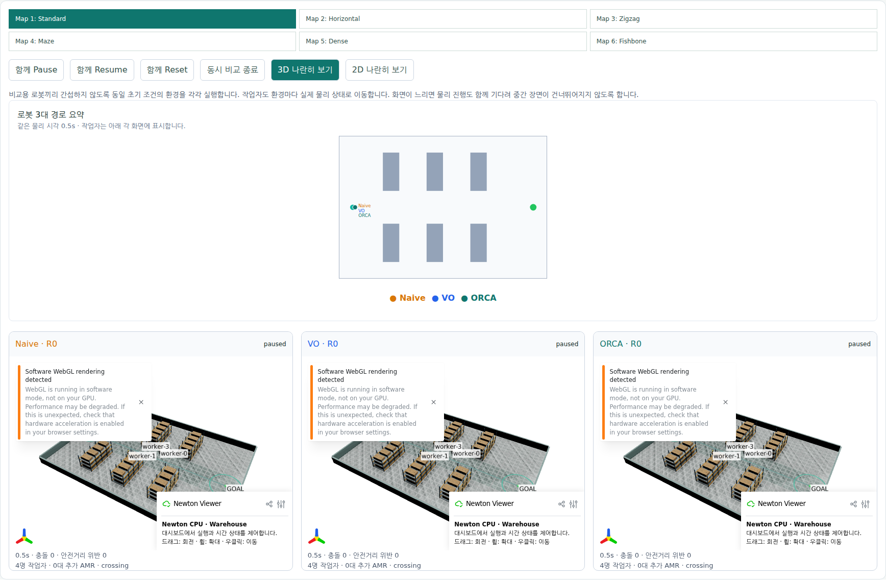
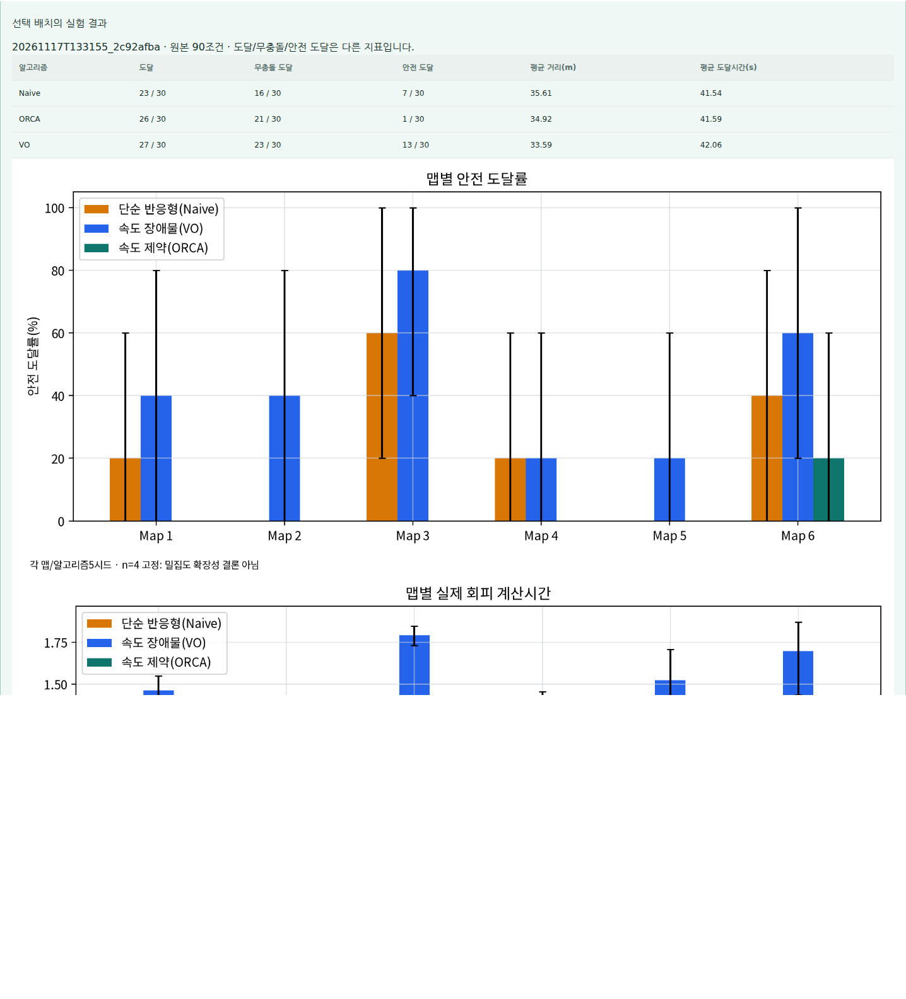
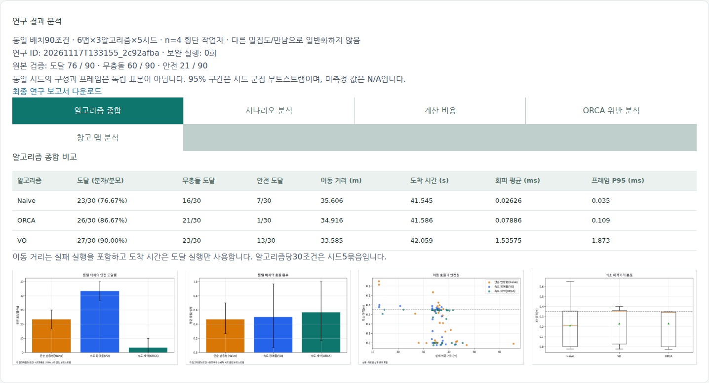
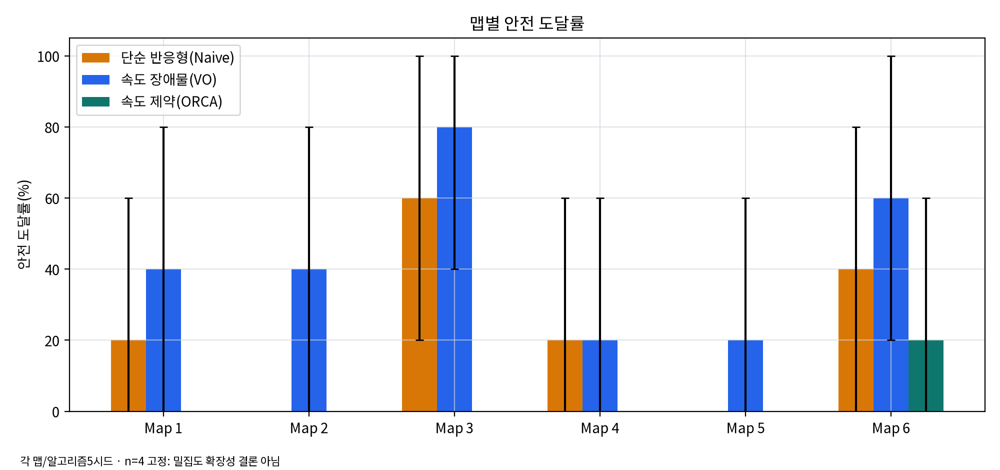

# 프로젝트 이름 : Warehouse Collision Avoidance — Newton 물류창고 충돌 회피 시뮬레이터

**6종 물류창고에서 Naive·VO·ORCA의 실제 주행을 나란히 관찰하고, 같은 조건의 실험 결과를 안전성·이동 효율·계산 비용으로 비교하는 프로젝트입니다.**

[팀원 공유 보고서 PDF — 프로젝트 구성·90조건 결과·연구 분석](docs/team-project-summary-ko.pdf)

## 1. 프로젝트 이름과 소개

사람과 이동 로봇이 함께 움직이는 창고에서 목적지까지 가는 과정을 Python 물리 시뮬레이션으로 구현했습니다. 전역 탐색이 선반을 피하는 경로를 만들고, 지역 회피가 작업자·다른 로봇을 고려해 매 프레임 목표 속도를 결정합니다. 화면의 이동뿐 아니라 Newton 강체의 실제 위치·속도·접촉을 기준으로 결과를 기록합니다.

현재 기본 결과는 **6개 맵 × 3개 회피 알고리즘 × 5개 시드 = 90조건**의 통일 배치입니다. 이전 60회·240회 실험은 별도 자료로 보존하며 현재 결과의 분모에 합치지 않습니다.

### 주요 기능

| 기능 | 내용 |
|---|---|
| 6종 창고 | Standard, Horizontal, Zigzag, Maze, Dense, Fishbone |
| 전역 경로 탐색 | A*, Dijkstra, RRT |
| 지역 회피 | 직접 구현한 Naive, Velocity Obstacles(VO), ORCA |
| 세 알고리즘 동시 실행 | 같은 초기 조건의 독립 물리 환경 3개를 나란히 실행 |
| 실행·기록 제어 | 함께 Start·Pause·Resume·Reset, 단일 실행과 기록 탐색 |
| 2D·3D 관찰 | 같은 물리 상태의 Top View와 Viser 강체 시각화 |
| 첫 렌더 동기화 | 3D 세 장면 준비 후 함께 시작, 화면 처리 진도에 따른 진행 제한 |
| 실험 조건 통일 | Crossing/workers, 속도·안전거리·시간 간격·프레임 한도 일치 |
| 같은 배치의 결과·연구 | 비교 표·실험 결과·연구 분석이 동일한 90개 실행 ID 사용 |
| 원본 보존 | 실행별 설정·초기 상태·결과·궤적·코드 해시·의존성 보관 |
| 연구 분석 | 맵별 결과, 짝지은 비교, 시드 군집 신뢰구간, ORCA 진단, 그래프 19종 |

### 알고리즘의 역할

- **A***는 이동 비용과 목적지까지의 추정 비용으로 격자 경로를 탐색합니다.
- **Dijkstra**는 누적 비용 순으로 탐색합니다.
- **RRT**는 표본 기반 트리를 확장합니다. 이 구현에서 최단 경로 최적성을 보장하지 않습니다.
- **Naive**는 현재 거리로 감속·반발 속도를 계산하며 미래 충돌을 예측하지 않습니다.
- **VO**는 상대 위치·속도로 충돌을 예측하고 후보 속도를 평가합니다.
- **ORCA**는 속도 반평면 제약과 순차 2차원 선형계획으로 속도를 구합니다.

ORCA는 프로젝트 내부 구현으로 외부 RVO2를 사용하지 않습니다. 현재 작업자·추가 AMR은 서로 회피하지 않는 순찰 에이전트이며, R0가 회피 책임을 전부 부담합니다. 화면 비교의 세 로봇은 서로 다른 환경에서 실행되어 비교 로봇끼리 간섭하지 않습니다.

## 2. 사용한 기술

| 구분 | 기술 | 사용 목적 |
|---|---|---|
| 언어 | Python 3.12, TypeScript | 시뮬레이션·실험·분석, 웹 제어 |
| 물리 엔진 | Newton 1.7.0, NVIDIA Warp 1.19.0 | CPU 강체·접촉·힘 제어 |
| 3D 화면 | Viser 1.1.1, 브라우저 WebGL | 창고·로봇·작업자·경로 시각화 |
| 수치·통계 | NumPy, Pandas, SciPy | 상태 처리, 집계, 기하·통계 분석 |
| 그래프 | Matplotlib, Noto Sans KR | 한국어 그래프·분포·신뢰구간 표시 |
| 초기 2D 구현 | pygame-ce | 독립 2D 예비 실험 |
| 검증 | pytest, Node.js, Playwright, Chromium | 물리·저장·분석·UI·실제 브라우저 검사 |
| 관리 | Git, GitHub, CSV, JSON | 소스·설정·측정 자료와 이력 관리 |

Newton용 설치 항목은 [requirements-newton.txt](requirements-newton.txt), 초기 Pygame 구현은 [requirements.txt](requirements.txt)에 있습니다. Noto Sans KR 글꼴의 SIL OFL 라이선스는 fonts/에 포함합니다. 브라우저 자동 검사를 실행할 때는 Playwright와 Chromium이 추가로 필요합니다.

### 기본 실험 환경

38 × 26m 창고, R0 반경 0.42m, 최대 속도 1.2m/s, 안전 여유 0.35m, 시간 간격 1/30초를 사용합니다. 현재 통일 배치는 medium·작업자 4명·Crossing·A*·동적 순찰·5400프레임이며 시드 42~46을 사용합니다. Fishbone은 논문을 참고한 자체 배치입니다.

## 3. 실행 화면

아래 이미지는 **2026-11-17 실제 Newton CPU 실행과 Chromium 검증에서 저장한 화면**입니다. 기능 설명용 목업이 아닙니다. 이번 Git 갱신에서 실험 90조건과 브라우저 전체 검증을 새로 실행한 것으로 해석하지 마십시오.

### 세 알고리즘의 동시 3D 실행



공통 맵과 제어 버튼 아래에 Naive·VO·ORCA의 실제 강체 상태를 표시합니다. **3D · 첫 장면부터 보기**를 선택하면 세 장면의 첫 렌더를 확인한 뒤 출발합니다. 캡처 서버의 소프트웨어 WebGL 안내도 실제 환경의 일부입니다.

기본 2D 모드는 표시 비용을 줄이며 3D 모드에서는 뷰어 세 개를 연결합니다. 표시 경로 256점·3D 갱신 10Hz와 바이너리 묶음 전송을 적용했습니다. 물리 계산·전체 결과 기록은 유지하며, 느린 화면을 따라가기 위해 벽시계 실행 속도가 늦어질 수 있습니다.

### 통일 배치의 실험 결과



알고리즘 비교·실험 결과·연구 분석은 같은 배치 ID와 실행 ID 집합을 읽습니다. 임시 단일 시드 실행은 연구 배치를 자동으로 교체하지 않습니다.

### 연구 분석 화면



도달률뿐 아니라 무충돌·안전 도달, 회피 계산 비용, 맵별 차이와 ORCA 진단을 확인합니다.

### 맵별 안전 도달률



각 맵·알고리즘은 5개 시드의 관측입니다. 제한된 조건의 실측이며 모든 환경에서의 순위나 무충돌을 보장하지 않습니다.

### 현재 90조건의 결과

| 방식 | 목적지 도달 | 무충돌 도달 | 안전 도달 | 평균 회피 계산시간(ms/step) |
|---|---:|---:|---:|---:|
| Naive | 23/30 | 16/30 | 7/30 | 0.02626 |
| VO | 27/30 | 23/30 | 13/30 | 1.53575 |
| ORCA | 26/30 | 21/30 | 1/30 | 0.07886 |
| 합계 | 76/90 | 60/90 | 21/90 | — |

도달·무충돌·안전 도달은 서로 다른 지표입니다. 안전 도달은 도달·무충돌에 더해 정적·동적 안전 여유 조건까지 만족해야 합니다. 표는 보존된 측정 자료의 집계이며 새로 만든 값이 아닙니다.

[배치 조건과 한계](docs/unified_batch.md), [연구 보고서](results/newton/research/20261117T133155_2c92afba/research_report.md), [측정 원본 CSV](results/newton/studies/20261117T133155_2c92afba/measurements.csv)를 함께 확인하십시오.

## 4. 실행 방법

### 4-1. 설치

Linux·macOS Bash와 Python 3.12 기준입니다.

```bash
git clone https://github.com/xericen/Robot.git
cd Robot/warehouse-collision-avoidance
python3.12 -m venv .venv
source .venv/bin/activate
python -m pip install --upgrade pip
python -m pip install -r requirements-newton.txt
```

독립 Python 시뮬레이터와 Viser 뷰어는 아래 명령으로 실행합니다. 웹 대시보드는 시뮬레이션 API가 연결된 서비스에서 사용하며, 이 저장소를 받는 것만으로 전체 웹 서비스가 자동 구동되는 구성은 아닙니다.

### 4-2. 화면 없이 CPU 주행

```bash
python newton_warehouse.py \
  --algorithm orca --scenario medium --agents 4 \
  --map map1 --planner astar --seed 42 \
  --frames 5400 --viewer null
```

종료 결과와 CSV에서 주행 상태를 확인합니다. 짧은 실행 확인은 `--frames 30`으로 할 수 있지만 1초에 불과하여 timeout이 정상적으로 나올 수 있습니다.

- 회피: `--algorithm naive|vo|orca`.
- 맵: `--map map1`부터 `map6`.
- 전역 탐색: `--planner astar|dijkstra|rrt`.
- 작업자 모드: `--traffic-mode static|dynamic`.
- 파라미터: `--parameters '{"vo_candidates":74,"orca_horizon_s":3}'`.

이 CLI 예시는 기본 주행 확인용입니다. 최신 연구와 정확히 같은 Crossing/workers 전체 조건은 다음 통일 배치 러너를 사용하십시오. 설정이 다른 CLI 결과와 연구 결과를 합쳐 집계하지 않습니다.

### 4-3. 독립 3D 뷰어

```bash
python newton_warehouse.py \
  --algorithm orca --scenario medium --agents 4 \
  --map map1 --planner astar --frames 5400 \
  --viewer viser --port 8080
```

실행 로그의 주소를 브라우저에서 엽니다. 같은 PC의 기본 주소는 `http://localhost:8080`이며 원격 서버는 포트 접근이나 SSH 포워딩이 필요합니다.

### 4-4. 웹 화면 사용

1. 알고리즘 **구현** 화면에서 맵·탐색기·작업자 조건을 선택합니다.
2. **Start · 3개 알고리즘 함께**를 누르면 같은 초기 조건의 세 환경을 실행합니다.
3. 가벼운 기본 2D 또는 **3D · 첫 장면부터 보기**를 선택합니다.
4. **함께 Pause / Resume / Reset**으로 제어합니다. 맵 전환은 세 환경을 새로 준비합니다.
5. **알고리즘 비교**에서 검증된 공통 배치의 원본 결과를 확인합니다.
6. **실험 결과 / 연구 분석**에서 같은 배치 ID의 통계·그래프를 읽습니다.

새 세션은 비교와 동일한 지정 프레임 한도를 지킵니다. 기존 세션은 종료하고 새로고침한 뒤 새 Start를 사용하십시오. 3D 첫 준비 대기·표시 진도 제한의 설명은 [표시 동기화 문서](docs/viewer_presentation_sync.md)에 있습니다.

### 4-5. 새로운 90조건 배치 생성과 검증

```bash
# 6개 맵 × 3개 알고리즘 × 5개 시드: 새 배치 ID 생성
python unified_batch.py

# 아래 문자열을 방금 생성한 실제 배치 ID로 변경
BATCH_ID='생성된_배치_ID'

# 중단된 동일 배치 재개: 완료 조건은 건너뜀
python unified_batch.py --resume "$BATCH_ID"

# 완료된 같은 배치로 통계·그래프·보고서 생성
python unified_analysis.py "$BATCH_ID"

# 원본·CSV·대시보드 수치 검증 후 기본 배치 활성화
python verify_unified.py "$BATCH_ID"
```

기존 분석 폴더는 덮어쓰지 않습니다. 원본과 소스 조건이 맞지 않으면 재개·분석을 거부할 수 있습니다. 단순 결과 확인을 위해 장시간 주행을 재실행할 필요는 없습니다.

현재 보존된 배치 ID는 `20261117T133155_2c92afba`입니다. 독립 시드 묶음은 5개이며 알고리즘당 30행을 독립 시드 30개로 해석하지 않습니다.

### 4-6. 과거 실험과 결과 보관

기존 기준 실험도 재현할 수 있습니다. 아래 실행은 현재 90조건 연구와 별개입니다.

```bash
python newton_experiments.py compare
python newton_experiments.py sweep
python plot_newton_results.py
python newton_experiments.py reproducibility

# 작업자/혼합 인원 4단계 × 3방식 × 10시드: 240회
python controlled_study.py
```

| 경로 | 내용 |
|---|---|
| `results/newton/active_batch.json` | 검증된 기본 배치 포인터 |
| `results/newton/studies/` | 배치 설정·진행·측정 CSV |
| `results/newton/runs/` | 실행 ID별 설정·초기 상태·결과·궤적·코드/의존성 기록 |
| `results/newton/research/` | 배치별 분석·그래프·연구 보고서 |
| `results/newton/validation/` | 브라우저·실행 검증 자료 |
| `results/newton/figs/` | 과거 60회 스윕 그래프 |
| `results/csv/`, `results/figures/` | 초기 Pygame 예비 데이터 |
| `results/live/` | 로컬 실행 세션. 업로드 제외 |

과거 연구의 대용량 `orca_failure_analysis.csv`는 GitHub 단일 파일 제한 때문에 `.csv.gz`로 보관합니다. 이전 연구 도구에서 원래 파일이 필요하면 복원하십시오.

```bash
gzip -dk results/newton/research/20261117T115115_2ef7f604/orca_failure_analysis.csv.gz
```

최신 90조건 자료와 입력 해시는 원본 바이트를 유지합니다. 비밀키·환경 비밀값·실행 세션은 포함하지 않으며, 검증 문서의 접근용 세션 식별값은 마스킹합니다.

### 4-7. 지표·테스트

- **도달**: 목적지까지 0.25m 이내이고 실제 속력이 0.02m/s 이하.
- **도달시간**: 성공한 실행의 물리시간. 미도달은 빈 값 또는 N/A.
- **충돌**: 바닥을 제외한 R0의 접촉 진입.
- **안전거리 위반**: 거리 기준의 위험 진입. 도달 성공과 별도로 기록.
- **회피 계산시간**: 회피 함수의 평균·최악·실제 기록된 분포. 물리·렌더링·전역 계획 시간 제외.
- **wall time**: 초기화·계획·물리·회피·렌더링 등을 포함하는 실행시간.
- **재탐색**: 초기 계획 이후 온라인 재탐색은 현재 미구현.

```bash
python -m pytest
node tests/test_unified_ui.cjs
```

전체 테스트에는 실제 CPU 물리 계산이 포함됩니다. 브라우저 검사는 실행 중인 시뮬레이션 서비스와 Playwright·Chromium이 필요합니다. 과거 검증 수치와 이번 업로드 검증은 작업 기록에서 구분합니다.

### 주요 구조

```text
Robot/
├── README.md
├── warehouse-collision-avoidance/
│   ├── algorithms/             # 탐색·회피 구현
│   ├── newton_warehouse.py      # Newton 강체 주행
│   ├── newton_live.py           # 실행·기록 제어
│   ├── presentation_sync.py     # 첫 렌더·표시 진도 동기화
│   ├── viewer_transport.*      # 바이너리 뷰어 전송
│   ├── unified_batch.py        # 90조건 공통 배치
│   ├── unified_analysis.py      # 같은 배치 연구 생성
│   ├── verify_unified.py        # 원본·분석 일치 검사
│   ├── controlled_study.py      # 과거 통제 실험 러너
│   ├── research_*.py            # 통계·ORCA·맵 분석
│   ├── tests/
│   ├── results/
│   └── docs/
└── src/                        # 웹 화면·API·뷰어와 결과 자료 연결
```

## 5. 만든 이유, 목표와 배울 점

### 만든 이유와 목표

선반을 피하는 최단 경로를 찾았더라도 작업자와 만나는 시점에 따라 위험한 접근이나 정지가 발생합니다. 이 프로젝트는 알고리즘 수업에서 다루는 탐색·기하·벡터 계산을 실제 움직이는 환경에 적용하고, 도달·안전·계산 비용을 함께 평가하기 위해 만들었습니다.

목표는 직접 구현한 알고리즘의 차이를 설명하고, 같은 초기 조건으로 비교하며, 실제 물리 결과를 재현 가능한 자료로 남기는 것입니다. 3D 화면은 관찰 도구이고 CSV·설정·원본 기록이 실험의 근거입니다.

### 배울 수 있는 점

- **전역 계획과 지역 회피 분리**: 선반을 피하는 경로와 움직이는 이웃에 대한 대응을 별도로 평가합니다.
- **공정한 실험 설계**: 시드뿐 아니라 초기 상태·만남 조건·속도·인원·프레임 한도도 일치시킵니다.
- **물리와 제어의 차이**: 목표 속도와 실제 속도는 다르므로 질량·마찰·힘 제어·시간 간격을 고려합니다.
- **이론과 실측 비교**: 기본 Naive O(n), VO O(Kn), ORCA 순차 투영 최악 O(n²)과 실제 Python·CPU 비용은 구분합니다.
- **통계적 해석**: 대응 조건의 차이, 시드 군집, 실패 실행과 도달시간의 선택 편향을 다룹니다.
- **결과 추적**: 원본·코드 해시·의존성·분석을 배치 ID로 연결하고 과거 자료를 보존합니다.
- **실시간 시각화**: 서버 계산이 화면보다 앞서 중간 장면이 사라지지 않도록 준비·표시 진도·전송량을 제어합니다.

### 현재 한계와 다음 목표

현재 대표 연구는 n=4·Crossing·5시드 조건입니다. 다른 밀집도·만남 조건·협조형 다중 로봇의 일반적인 성능을 주장하지 않습니다. 공유 CPU 서버의 부하와 캐시까지 통제한 절대 성능 벤치마크도 아닙니다.

다음 목표는 더 다양한 만남·시드·인원에서의 검증, 주변 에이전트 상호 회피, 공간 인덱스와 온라인 재탐색입니다. 표시 성능 개선이 물리 방정식이나 기존 실험 결과를 바꾼 것으로 해석하지 않도록 구분합니다.

[현재 연구 조건](docs/unified_batch.md) · [통제 실험 설계](docs/controlled_experiments.md) · [동시 비교](docs/simultaneous_comparison.md) · [표시 성능](docs/live_performance.md) · [알고리즘 분석](docs/algorithm_analysis.md)
