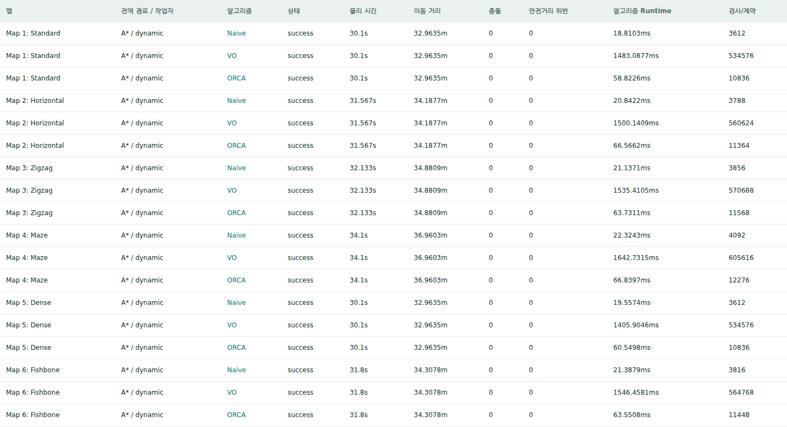
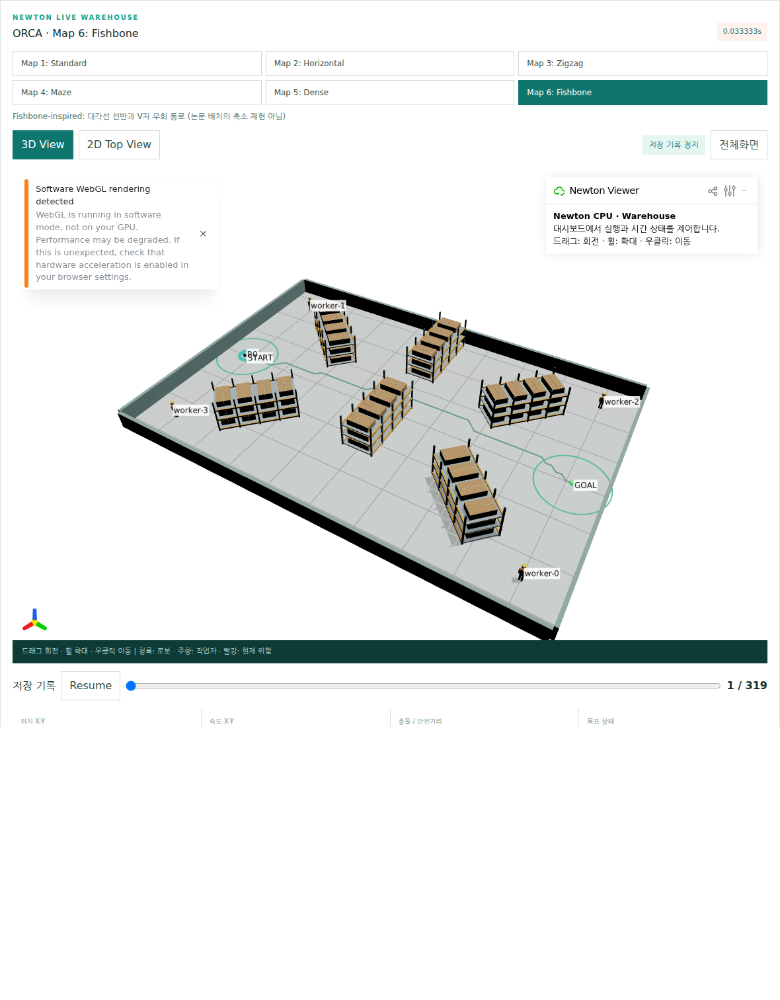

# 6개 맵 기준 지역 충돌 회피 비교 (2026-11-17)

알고리즘 비교 기본 범위를 **6개 맵 전체**로 변경했다. Standard/Horizontal/Zigzag/Maze/Dense/Fishbone 각각에서 Naive·VO·ORCA를 순차 실행해 총18건을 표시한다. 맵별로 API 요청을 나누어 진행 상황을 표시하고, 오류가 나면 그때까지 반환된 결과와 기존 기록을 보존한다. 기존 선택 맵3조건 비교도 유지한다.

## 실제 검증

브라우저에서 기본 범위 all → 실제 Newton CPU18조건 → 표18행 → Fishbone/Standard 기록3D재생 → Standard Reset의 공통 작업자 초기 위치 → 선택 맵3조건 비교 → 이전18결과 보존을 확인했다. 최종 console/pageerror0. 두 번째 단일 맵 검사는 프레임30으로 제한했고, 세 결과가 실제 timeout으로 표시되는 것도 확인했다.

- 실제 환경: Newton1.7.0 / Warp1.19.0 / CPU.
- 18조건: medium, R0 1대·worker-0~3, A* 전역 경로, 동적 작업자, seed42, 속도1.2m/s, 안전거리0.35m, 프레임3600.
- 공통 START(2.5,13) / GOAL(35.5,13), 맵 설정의 공통 작업자 초기 위치·왕복 목표.
- 18건 모두 success·정지, R0 충돌0·안전거리 위반0, contact_labels는 ground만 기록.
- hard 시나리오의 추가 AMR을 작업자 재배치에서 제외하도록 수정하고, 각 맵의 worker-0~3 공통 위치 및 강체 초기 비중첩을 실제 Newton 1frame 검사6개로 검증했다.
- WIZ 일반 빌드 통과.
- 최초 브라우저 검사에서는 다른 화면 표까지 포함해 행 수를24개로 판정했다. 검사 selector를 unified-dashboard 내부로 한정한 뒤 전체 흐름을 통과했다. 제품의18건 응답은 정상 반환되었다.

| 맵 | Naive 주행 s / 거리 m | VO 주행 s / 거리 m | ORCA 주행 s / 거리 m |
|---|---:|---:|---:|
| Map 1: Standard | 30.100 / 32.964 | 30.100 / 32.964 | 30.100 / 32.964 |
| Map 2: Horizontal | 31.567 / 34.188 | 31.567 / 34.188 | 31.567 / 34.188 |
| Map 3: Zigzag | 32.133 / 34.881 | 32.133 / 34.881 | 32.133 / 34.881 |
| Map 4: Maze | 34.100 / 36.960 | 34.100 / 36.960 | 34.100 / 36.960 |
| Map 5: Dense | 30.100 / 32.964 | 30.100 / 32.964 | 30.100 / 32.964 |
| Map 6: Fishbone | 31.800 / 34.308 | 31.800 / 34.308 | 31.800 / 34.308 |

위 시간은 실제 시뮬레이션 주행 시간이며 알고리즘 계산 CPU시간과 다르다. [실측 JSON](measurements.json), [브라우저 검사](browser-checks.json), [브라우저 실행 로그](warehouse-six-map-comparison.log), [hard 초기 배치 검사](common-comparison-traffic-tests.log).




## 변경 파일

- `src/app/page.algorithm.run/view.ts`: 전체 맵 기본 범위, 맵별3알고리즘 요청, 진행률·부분 오류·기존 결과 보존
- `src/app/page.algorithm.run/view.pug`: 비교 범위 선택,18조건 버튼, 맵별 결과 표
- `src/app/page.algorithm.run/api.py`: 공통 작업자 옵션 전달 및 기록 Reset 설정 복원
- `newton_warehouse.py`: CLI --common-traffic 및 결과 메타데이터, 작업자만 공통 배치 적용
- `tests/browser_all_map_comparison.py`, `tests/test_common_comparison_traffic.py`: 실제 전체 흐름·추가 AMR 회귀 검증
- 기존 `tests/browser_map_comparison.py`, `browser_layout.py`, `browser_warehouse.py`: 선택 맵 비교 버튼/범위를 새 UI에 맞춰 갱신 (이번에 이 세 스크립트 전체를 재실행하지는 않음)
- `README.md`, 이 결과 문서·JSON·캡처·로그 및 개발로그

기존 Naive/VO/ORCA 구현,6개 레이아웃,60조건 전역 경로 탐색 비교와 외부 패키지는 변경하지 않았다. 이전 기록은 유지한다.

## 사용·재현

알고리즘 비교 → 비교 범위 **6개 맵 전체** → **6개 맵 · 18조건 비교 실행**. 실행할 설정은 시작할 때 고정되며 맵별 결과가 차례로 표시된다. 각 행의 알고리즘을 누르면 해당 맵을 복원해 재생한다.

```bash
WAREHOUSE_CHROMIUM=/path/to/chromium python tests/browser_all_map_comparison.py
.venv/bin/python -m pytest tests/test_common_comparison_traffic.py
```

실험 결과 탭의 A*/Dijkstra/RRT60조건 실험은 별도 기능이다. 전체 비교에서24×16m 레거시 시나리오는38×26m medium으로 전환한다. easy/medium의 공통 작업자와 hard/crowded의 추가 인원은 역할을 구분해 배치한다. 모든 시드·속도·인원 조건을 검증한 것은 아니며 프레임 한도 내 미도달은 timeout이다.
