# Newton CPU 경로 탐색 실측 결과

실행일: 2026-11-16. [원시 60건과 조건별 평균·분산](measurements.json), [전체 지표 CSV](summary.csv).

## 실험 환경과 조건

Python3.12.3, Newton1.7.0, Warp1.19.0 CPU. 38×26m, 3×7×3.2m 선반6개, R0 radius0.42m/1.2m/s, 안전거리0.35m, START(2.5,13), GOAL(35.5,13)을 고정했다. 모든 맵·탐색기는 작업자4명을 유지하며 같은 초기 위치·순찰 목표·인원 시드42를 사용했다. 정적은 목표 속도0, 동적은 순찰이다. 전역 planner 비교 중 지역 회피는 ORCA로 고정했다.

A*/Dijkstra는 각 조건1회, RRT는 시드42/43/44 각1회로 정적30건+동적30건=60건이다. RRT 제한은 3000회/3초, step1.5m, goal bias0.15이다. 각 주행은 최대3600frame(120초), 도달거리≤0.25m 및 속도≤0.02m/s일 때만 성공이다.

A*/Dijkstra는 동일한 0.5m 8연결 격자를 사용하므로 해당 격자에서 길이를 비교한다. RRT는 연속 샘플링 + shortcut이며 동일한 최적성을 보장하지 않는다. 회전된 실제 선반 OBB와 원형 로봇으로 충돌 검사한다.

## 결과 요약

아래 길이는 계획 경로 길이(m), RRT는 3회 평균이다. 정적/동적에서 계획 입력은 같고, 실제 주행 시간과 거리는 별도로 CSV에 기록했다.

| 맵 | A* | Dijkstra | RRT 평균 | 정적/동적 도달 |
|---|---:|---:|---:|---|
| 1 Standard | 33.00 | 33.00 | 33.00 | 모두 성공 |
| 2 Horizontal | 34.66 | 34.66 | 36.87 | 모두 성공 |
| 3 Zigzag | 35.49 | 35.49 | 38.26 | 모두 성공 |
| 4 Maze | 37.90 | 37.90 | 37.93 | 모두 성공 |
| 5 Dense | 33.00 | 33.00 | 33.00 | 모두 성공 |
| 6 Fishbone-inspired | 35.07 | 35.07 | 35.24 | 모두 성공 |

60건 모두 목표 도달·정지, R0 충돌0, 안전거리 위반0, contact_labels=ground만 기록했다. 정적 작업자의 XY 최대 변위는0m였다. 이번 제한된 조건의 관측이며 일반적인 무충돌 보장이나 논문의 성능 재현 결과가 아니다. Fishbone이 Standard보다 짧다는 결과도 나오지 않았다.

RRT Map2/3/4/6 경로 길이의 모분산은 각각10.4277/26.8637/0.00685/3.5939 m²다. A*/Dijkstra 분산은 반복1회이므로 N/A다. RRT Expanded Nodes도 N/A이며 반복 수는 원시 행에 별도로 기록한다.

## 그래프

막대는 평균, PNG 오차막대는 모표준편차다. A*/Dijkstra는 반복1회라 분산을 추정하지 않는다. 시간 값은 이 서버의 CPU 실측이며 다른 동시 작업·캐시 상태의 영향을 받는다.

| 지표 | 정적 | 동적 |
|---|---|---|
| 계획 경로 길이 | 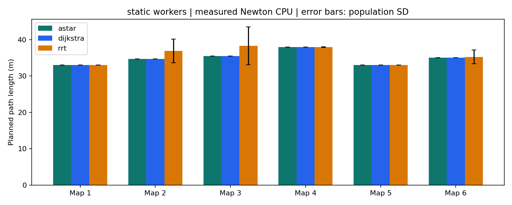 |  |
| 계획 계산 시간 | 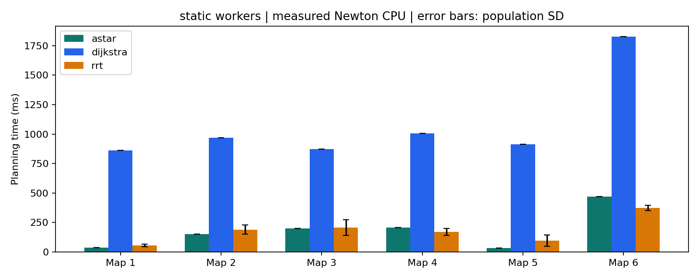 | 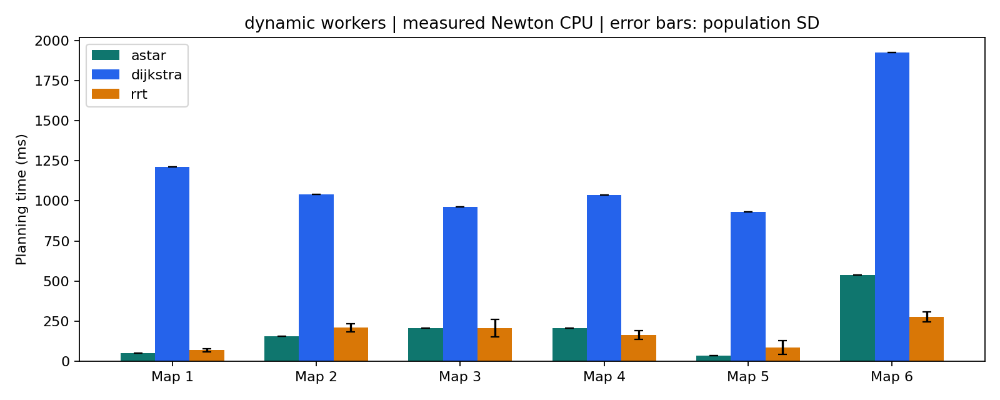 |
| Newton 주행 성공률 | 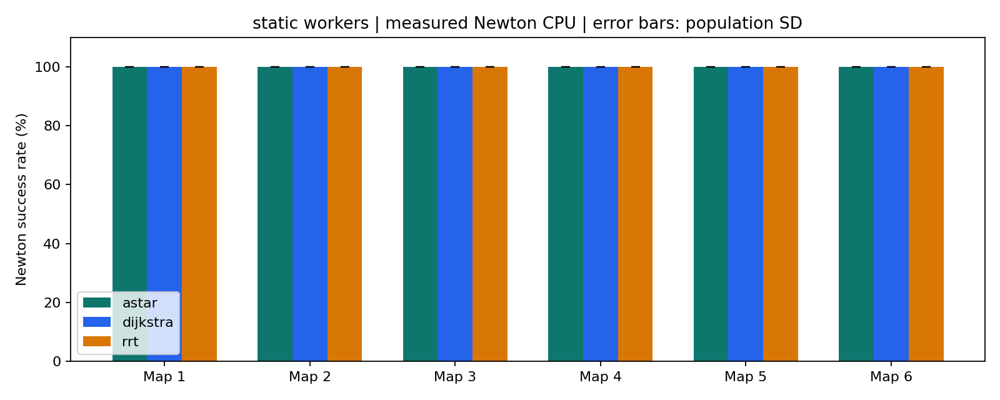 |  |

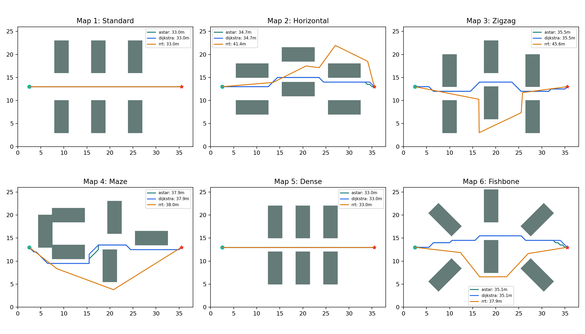

파랑/청록/주황 경로가 일부 겹치는 것은 실제 계산 결과가 같기 때문이다. PNG 경로 패널은 각 탐색기의 시드42 실행을 표시한다. 웹 실험 결과 화면에서는 계획 경로와 실제 Newton 주행 궤적을 함께 확인할 수 있다.

## Newton Viewer 실캡처

| 1 Standard | 2 Horizontal | 3 Zigzag |
|---|---|---|
| 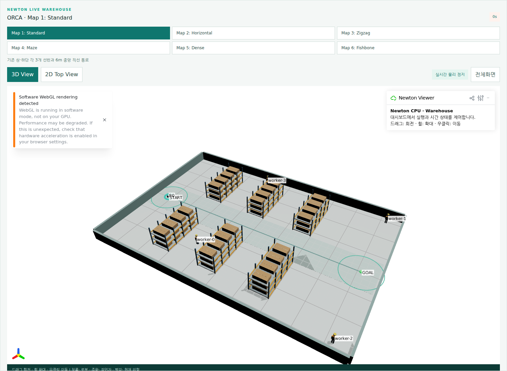 | 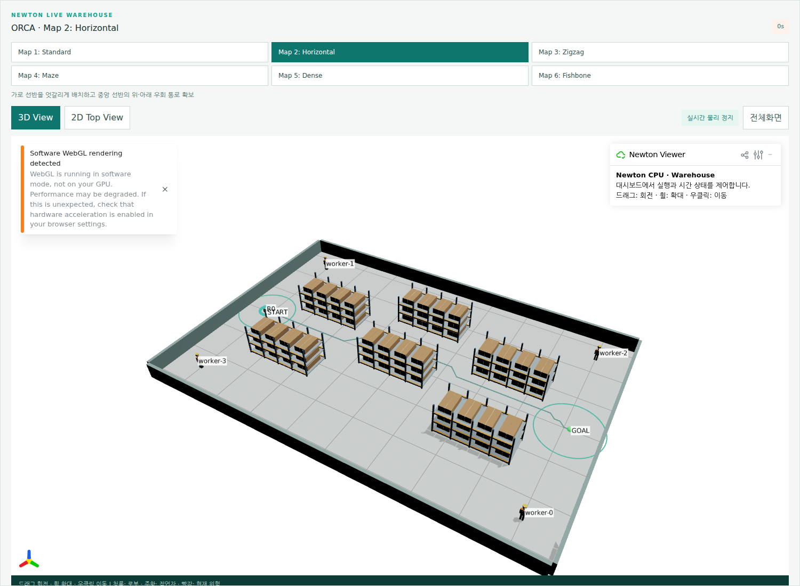 | 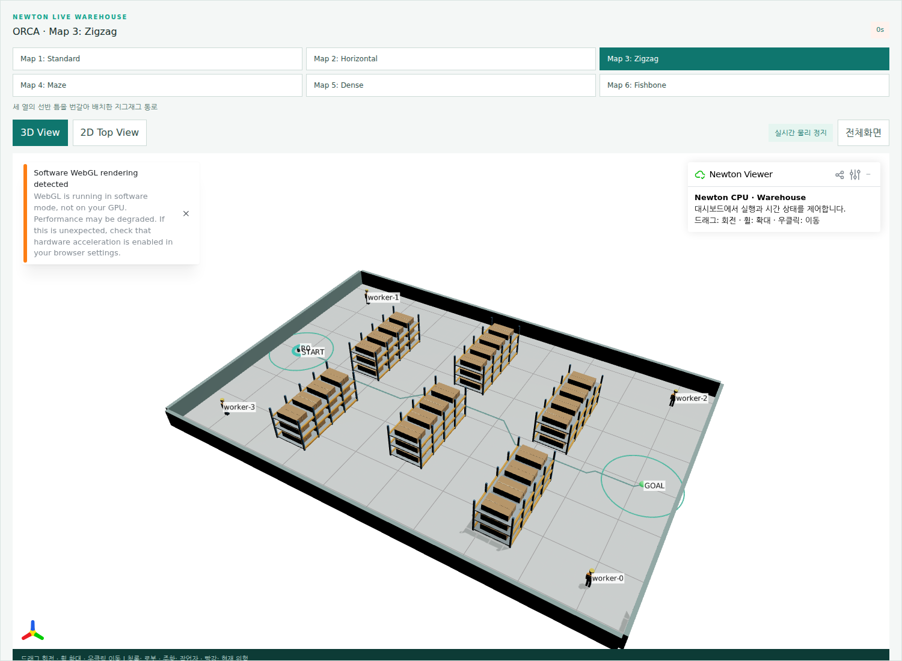 |
| 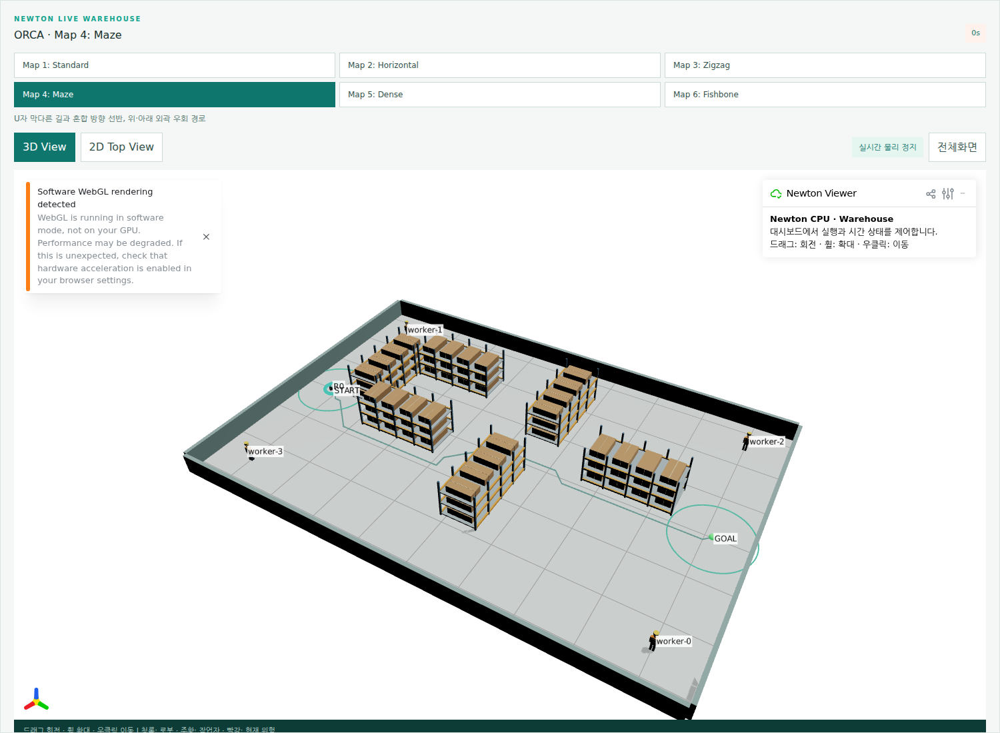 | 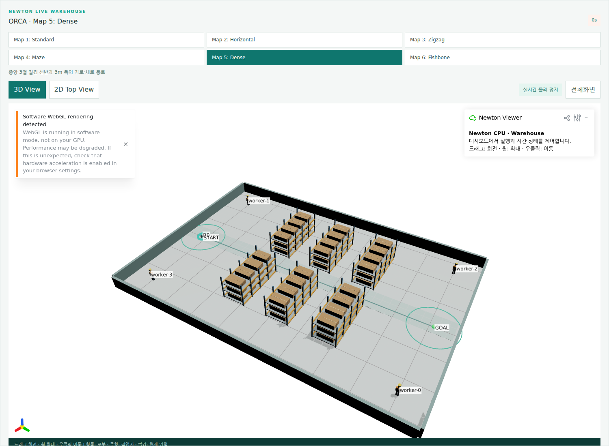 | 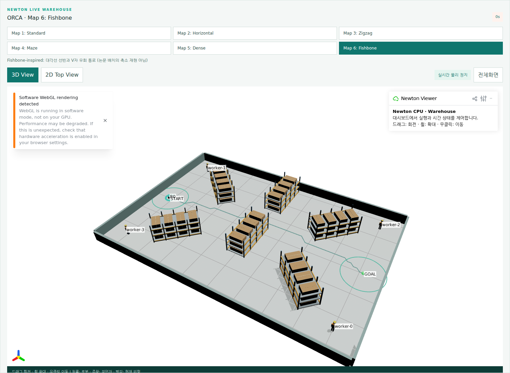 |

CPU Newton의 실제 강체와 Viser 브라우저 WebGL 렌더링이다. 브라우저는 GPU 부재로 SwiftShader를 사용했다.

## 검증과 오류 해결

- pytest 전체101개 중100개 통과·1개 실패: 공통 START 적용 후 Maze가 안전거리1m에서 유효하지 않았음. U자 선반3개를 X+1m 이동하고 영향 범위 맵 검사48개를 재실행해 모두 통과했다. 총101개 검사 항목의 최종 통과를 확인했다.
- 변경된 Maze 기하가 포함되지 않은 정적 실험5건은 새 배치에서 재실행하여 원시 결과를 교체했다. 모든 최종 원시 행의 기하가 현재 JSON과 일치하는지 대조했다.
- 브라우저에서6개 맵·8회 반복 전환, 각6선반과5동적 강체 ID, 초기 시간/경로, Resume, 2D/3D 렌더링, console/pageerror0 확인. 변경된 Maze 화면은 별도 재캡처했다.
- 탐색기 설정을 polling이 덮어쓰는 UI 버그를 발견해 새 세션 수신 때만 설정을 동기화하도록 수정했다.
- 초기 브라우저 스크립트의 비동기 제어 완료 대기와 label 선택을 보완했다. 최종 결과 화면·Dijkstra/RRT 실제 전환 검증 로그는 logs/에 보관한다.
- Newton 전용 가상환경에는 Matplotlib이 없어 첫 PNG export가 실패했다. 기존 분석용 Python의 Matplotlib을 사용했으며 환경 패키지는 변경하지 않았다.
- WIZ 일반 빌드 성공. 배포·게시·서비스 재시작은 하지 않았다.

[실행 로그](logs/), [참고 자료와 전체 좌표·회전값](../research_layouts.md).

## 재현

```bash
cd warehouse-collision-avoidance
.venv/bin/python planning_study.py --rrt-repeats 3
# numpy/matplotlib가 설치된 분석용 Python:
python export_planning_study.py
.venv/bin/python -m pytest tests
# Playwright가 설치된 Python과 Chromium:
WAREHOUSE_CHROMIUM=/path/to/chromium python tests/browser_shelf_maps.py
WAREHOUSE_CHROMIUM=/path/to/chromium python tests/browser_planning_study.py
```

웹의 실험 결과 → 60조건 Newton CPU 실험 실행으로 같은 실험을 시작할 수 있다. 실행 중 부분 결과를 표시하며 동일 서버에서 순차 수행한다. 원래 Naive/VO/ORCA 비교와 legacy 기록 재생도 유지한다.

## 한계

6개 맵은 연구 아이디어를 참고한 자체 설계이며 원 논문 레이아웃/throughput 재현이 아니다. Fishbone 원문은 접근 제한으로 초록·하이라이트만 확인했다. 작업자 간 상호 회피·온라인 재탐색은 추가하지 않았다. Turns는 계획 경로의15도 이상 변화 수이며 실제 강체 회전 횟수는 N/A다. 단일 START/GOAL과 RRT3회만 사용한 소규모 검증이므로 대규모·다중 쿼리 통계 검증이 필요하다.

## 실제 Viewer 및 결과 UI 캡처

| Standard | Horizontal | Zigzag |
|---|---|---|
|  |  |  |
|  |  |  |

[정적 결과 UI](screenshots/static-results.png) · [동적 결과 UI](screenshots/dynamic-results.png) · [정적 경로 전체](static-paths.png) · [동적 경로 전체](dynamic-paths.png).

## 최종 테스트

- 전체 pytest 101개 중 최초 Map4/안전거리1m에서 1개 실패. 공통 START와의 여유를 확보하도록 U자 선반을 이동한 후 관련 맵 테스트48개 전부 통과했다. 나머지100개 통과 결과와 합쳐 최종101개 검증. 통과한 전체 검사를 불필요하게 반복하지 않았다.
- 실제 Chromium: 8회 맵 전환·6개 3D 장면, 수정된 Maze 추가 전환·캡처, R0/worker-0~3 유지, 2D 회전, Dijkstra/RRT dispatch, Pause/Resume/Reset, 정적·동적 표 각18행, 그래프3개/막대54개, N/A 및 경로 다이어그램 확인. 최종 console/pageerror0.
- 실제 실험 실행 버튼: 별도 smoke worker를 시작해 첫 Newton 조건 성공, 동일 worker 재사용, 종료된 worker 오류 상태 감지를 확인했다. 이미60건을 검증했으므로 smoke worker는 SIGTERM으로 종료하고 완료된 결과를 복원했다. 첫 SIGINT 종료 요청은 서비스에서 상속된 신호 처리로 종료되지 않아 해당 테스트 worker에 SIGTERM을 사용했다.
- 일반 빌드 통과. 그래프/CSV/JSON/캡처는 실제 측정 데이터다.

## 변경 파일

- 맵/물리: `warehouse_maps.json`, `warehouse_maps.py`, `simulator/physics.py`, `newton_warehouse.py`
- 탐색: `algorithms/pathfinding.py`, `algorithms/planners.py`
- 실험/내보내기: `planning_study.py`, `export_planning_study.py`
- 웹: `src/app/page.algorithm.run/{api.py,view.ts,view.pug,view.scss}`
- 테스트: `tests/test_warehouse_maps.py`, `tests/test_planners.py`, `tests/browser_shelf_maps.py`, `tests/browser_planning_study.py`
- 문서/결과: `README.md`, `docs/warehouse_maps.md`의 이전 기록 안내, `docs/research_layouts.md`, 이 폴더의 측정 JSON/CSV·PNG8개·캡처8개·실행 로그
- 개발로그: 프로젝트 `devlog.md`, `devlog/2026-11-16/001-research-layout-planning.md`, ReviewOps `/opt/app/devlog/20261116/003-research-layout-planning.md`

기존 `newton_minimal.py`, 모델/박스 생성 모듈, Naive/VO/ORCA 구현과 가상환경 패키지는 수정하지 않았다.
