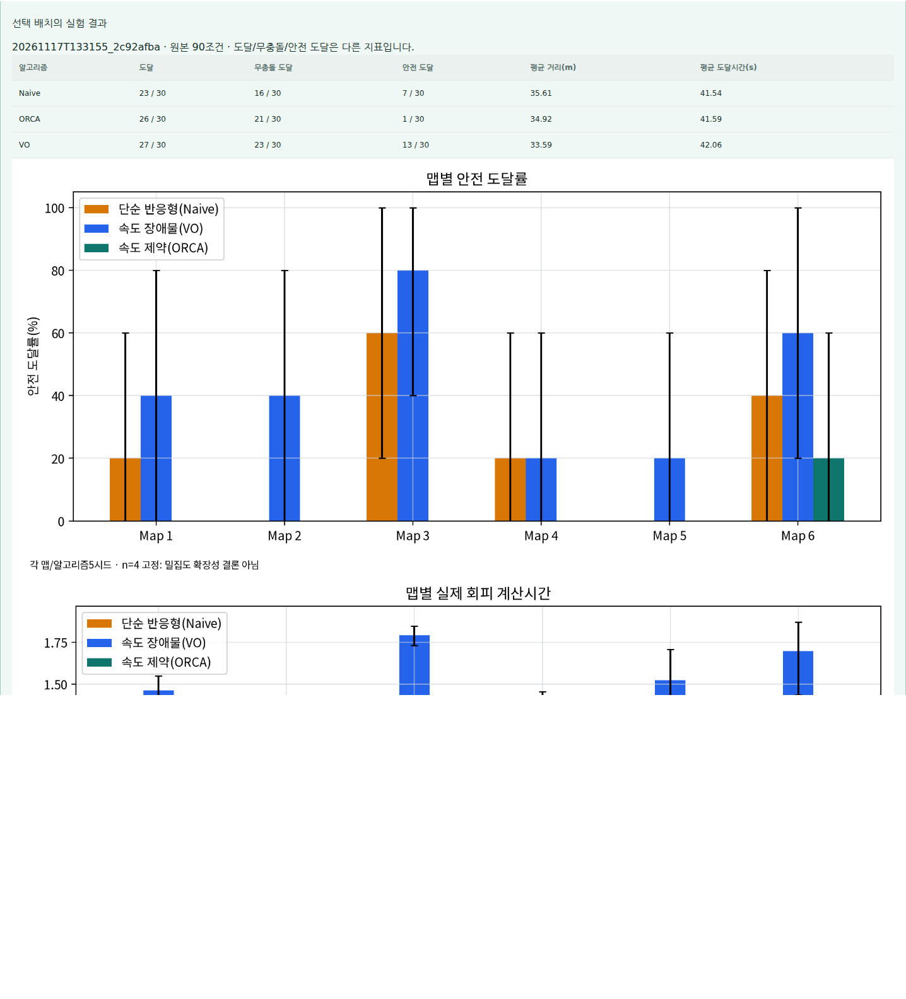
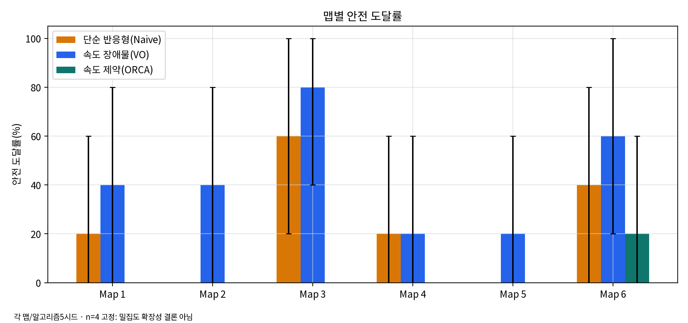
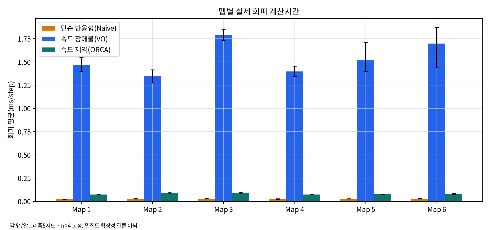

# 조건 통일 및 6맵 반복 실험 재생성

## 완료 배치

**20261117T133155_2c92afba**

6맵 × Naive/VO/ORCA × 시드42~46 = **실제 Newton CPU 주행90조건**. 기존240회·과거18회·Pygame 자료는 같은 분모에 넣지 않고 보존했다. 최신 통일 배치는 원본·분석·웹 수치를 검증한 뒤 `results/newton/active_batch.json`으로 활성화한다.

- [원본 배치 측정 CSV](../results/newton/studies/20261117T133155_2c92afba/measurements.csv)
- [전체 설정·물리 소스 해시](../results/newton/studies/20261117T133155_2c92afba/configuration.json)
- [새 연구 보고서](../results/newton/research/20261117T133155_2c92afba/research_report.md)
- [맵·알고리즘별 평균/신뢰구간](../results/newton/research/20261117T133155_2c92afba/map_comparison.csv)
- [알고리즘 종합 통계](../results/newton/research/20261117T133155_2c92afba/algorithm_comparison.csv)
- [짝지은 차이·효과 크기](../results/newton/research/20261117T133155_2c92afba/paired_comparisons.csv)
- [입력 해시·원본 보호 감사](../results/newton/research/20261117T133155_2c92afba/audit.json)
- [독립 검증](../results/newton/research/20261117T133155_2c92afba/verification.json)

## 통일한 조건

Newton1.7.0/Warp1.19.0 CPU, medium, R0 1대·작업자4명, **Crossing/workers**, A*, 동적 순찰, 속도1.2m/s, 안전거리0.35m,5400프레임(180초), 공통 timeStep1/30s 및 동일8개 회피 파라미터다.

실시간·동시 실행·알고리즘 비교가 같은 명시적 파라미터를 전달한다. 기본 만남 조건을 live에서만 몰래 Crossing으로 바꾸던 처리를 제거했다. 새 웹 세션은 비교와 같은 프레임 한도를 지키며 짧은 한도를 자동 연장하지 않는다. 기존 CLI/구버전 세션의 목표 주행 모드는 보존한다. 기존 세션은 종료하고 새로고침 후 새 Start로 조건을 적용한다.

각 맵·시드의3알고리즘 초기 상태 hash가 같아 **30개의 대응 triplet**이 성립한다. 연구의 독립 시드 묶음은5개이며30회/알고리즘을30개 독립 시드로 계산하지 않는다. 순차CPU 실행이지만 공유 서버 부하·캐시 영향까지 통제한 절대시간 벤치마크는 아니다.

## 실제 결과

| 알고리즘 | 도달 | 무충돌 도달 | 안전 도달 | 평균 회피 시간 ms/step |
|---|---:|---:|---:|---:|
| Naive | 23/30 | 16/30 | 7/30 | 0.02626 |
| VO | 27/30 | 23/30 | 13/30 | 1.53575 |
| ORCA | 26/30 | 21/30 | 1/30 | 0.07886 |
| 합계 | 76/90 | 60/90 | 21/90 | — |

도달만으로 안전 우수성을 판단하지 않는다. 이번 관측에서는 VO의 안전 도달이 가장 많지만 회피 계산 비용도 크다. ORCA는 Naive보다 도달이 많아도 안전 도달은 적다. 이 결과를 다른 인원·시드·만남 조건의 보편적 순위로 일반화하지 않는다.

도착시간은 도달 실행에만 정의하며 미도달은 N/A다. 이동 거리와 회피 비용은 실패 실행도 포함한다. 안전 도달은 도달·무충돌·정적/동적 안전 여유 조건을 모두 만족해야 한다.

## 같은 배치의 화면과 그래프

웹의 **공통 실험 배치**에서 위ID가 선택된다. 알고리즘 비교는 전체5시드90개 원본 행을 표시하고, 실험 결과와 연구분석도 같은 run_id 집합을 사용한다. 단일 시드의 새 임시 비교는 별도로 표시하며 연구 배치를 자동 교체하지 않는다. 과거 호환CSV를 최신 실행으로 잘못 선택하지 않도록 실행별 기록을 우선한다.





실측 그래프19개와 별도 전역 탐색54회 계측을 생성했다. ORCA 위험 프레임12,808개에서 B4,974/D3,183/E4,651로 분류했다. 허용해가 있는데 출력이 위반한 A는 관측되지 않았다. B는 제약 출력/실제 속도 차이의 증거이며 단일 제어기 원인 확정이 아니다. E와 비협조적 작업자 조건만으로 단일 인과를 단정하지 않는다. 실제 관측된 대표 실행2개만 표시하며 사례를 지어내지 않았다.

## 검증

- 관련 pytest 총39개 범위 통과: 초기36개 통과, 무결성 조건3개를 보강한 뒤 해당12개 재검증. 동일9개를 두 번 더해48개로 보고하지 않는다.
- Node 실제 UI 메서드: live/비교의 Crossing·baseline × 전체·선택 범위4조합, 최신 실행별 기록 우선, 전체 배치의 다중 시드 유지 확인.
- 실제 live: 원본 배치와 초기 scene_hash 일치.30프레임을 지정한 세션이1초에서 실제 timeout하여 자동 연장이 없음을 확인.
- 실제 Chromium: 비교90행·결과3알고리즘·연구5메뉴·그래프 로드·동일 배치 ID·API/다운로드CSV/연구 JSON의90개 실행 ID 일치·콘솔/페이지 오류0.
- 원본2423개 해시 보존,90건 완료 마커/설정/마지막 물리 상태/핵심 코드 해시 검증.540개 입력 파일 및 웹 JSON↔6개 파생CSV의 모든 수치 열 대조 통과.
- 완료 배치 재개 시 신규 시뮬레이션0회, 원본 CSV 바이트 해시 동일.
- 일반 WIZ 빌드 성공. 배포·게시·git push·서비스 재시작 없음.

검사 중 Node 테스트의 TypeScript generic 제거 표현식을 수정하고 다시 통과했다. 제품 데이터나 물리 수치를 수정해 통과시킨 것은 아니다.

## 재현

```bash
cd warehouse-collision-avoidance
# 새90조건 배치(새ID 생성):
.venv/bin/python unified_batch.py
# 같은 배치 재개(완료조건은 건너뛰며 소스가 다르면 거부):
.venv/bin/python unified_batch.py --resume 20261117T133155_2c92afba
# 새로 완료된ID의 분석 생성(기존 분석 폴더 덮어쓰기 거부):
.venv/bin/python unified_analysis.py <새로운-배치-ID>
# CSV/JSON/물리 기록 검증 후에만 기본 배치 활성화:
.venv/bin/python verify_unified.py <배치-ID>
.venv/bin/python -m pytest tests/test_unified_batch.py tests/test_research_analysis.py tests/test_live_delivery.py
node tests/test_unified_ui.cjs
WAREHOUSE_BATCH_ID=20261117T133155_2c92afba WAREHOUSE_CHROMIUM=/path/to/chromium python tests/browser_unified_batch.py
```

실행은 resume 가능한 직렬 방식이다. 원본 실행별 configuration/initial_state/provenance/trajectory/metrics/complete 파일은 results/newton/runs/실행ID 아래에 보존한다.

## 범위·한계

이번 배치는 n=4·Crossing·5시드다. 인원 증가에 따른 확장성,Head-On/Narrow/Dense,협조형다중로봇은 새 배치의 결론에 포함하지 않는다. 해당 과거 연구는 [기존 별도 연구 보고서](../results/newton/research/20261117T115115_2ef7f604/research_report.md)로 남아 있다. 전역 탐색54회는 주행90회 분모에 합산하지 않는다. 라이브30프레임 검증도 연구 표본이 아니다. UI의 물리 소스 일치 표시가 달라지면 새 실험을 검토해야 한다.
