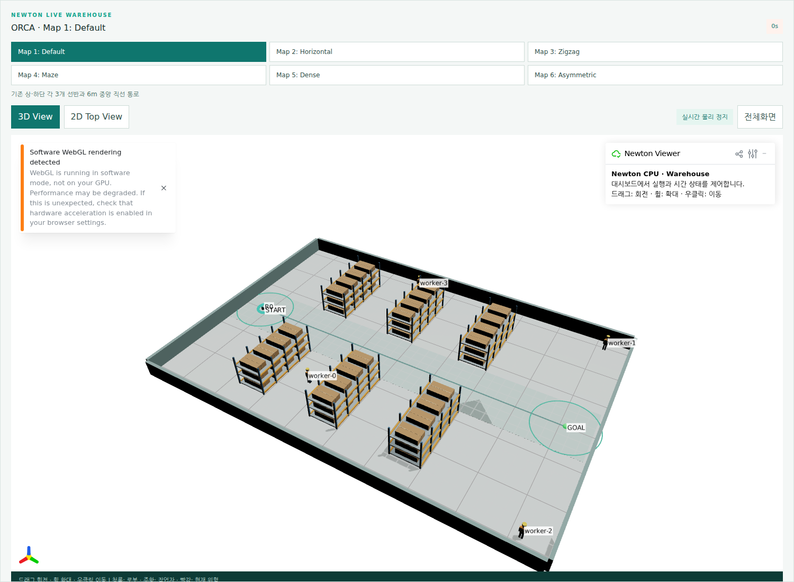
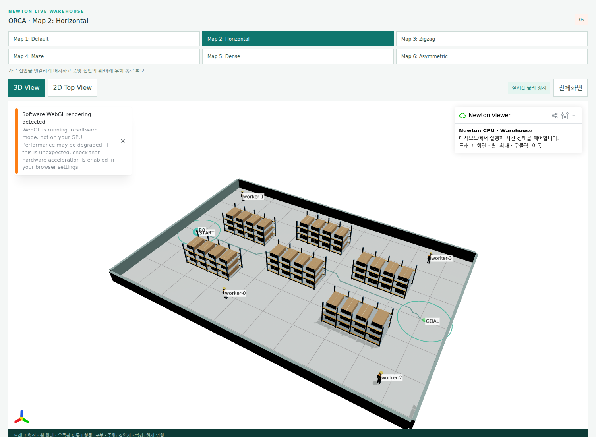
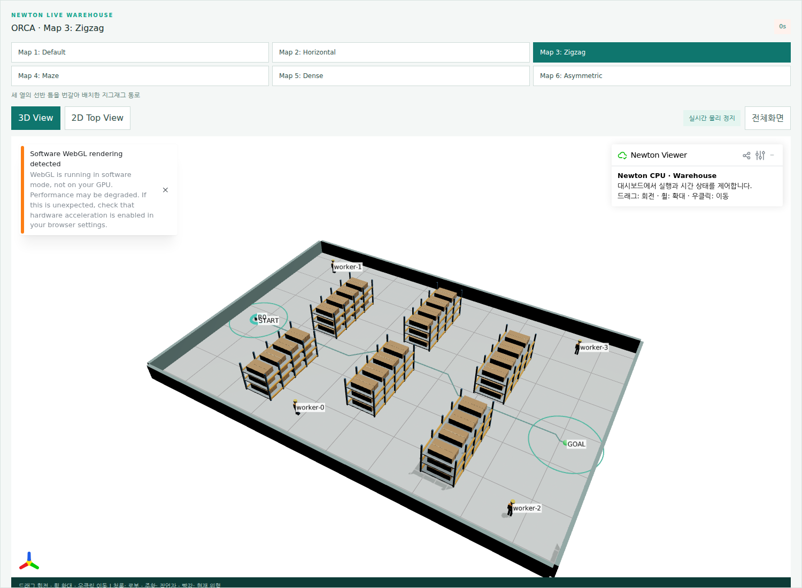
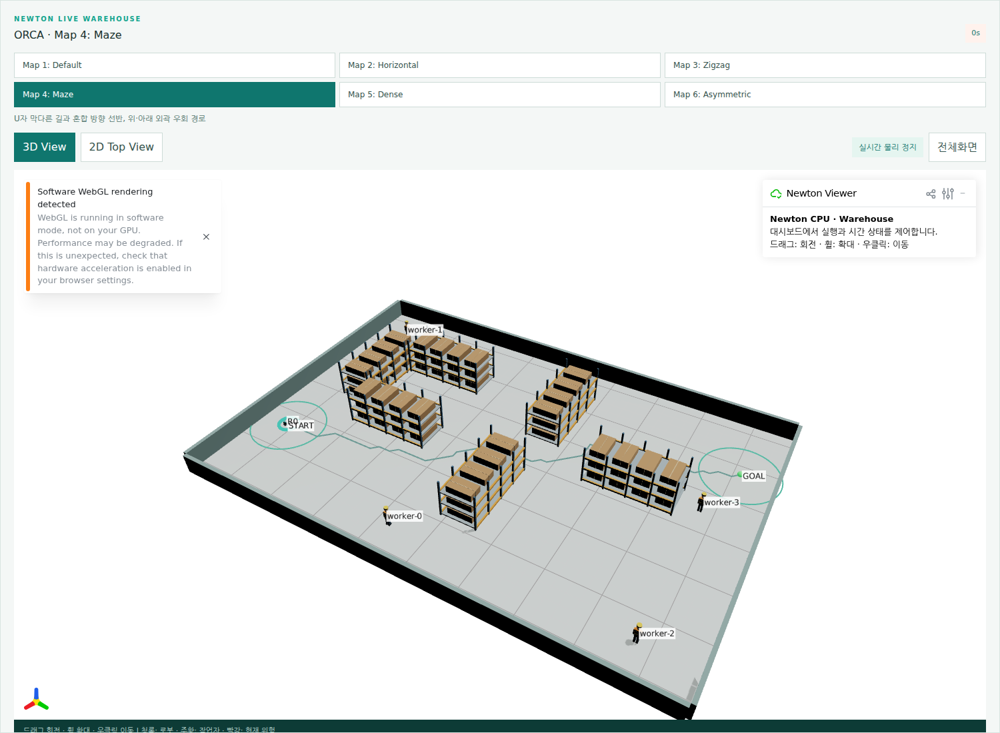
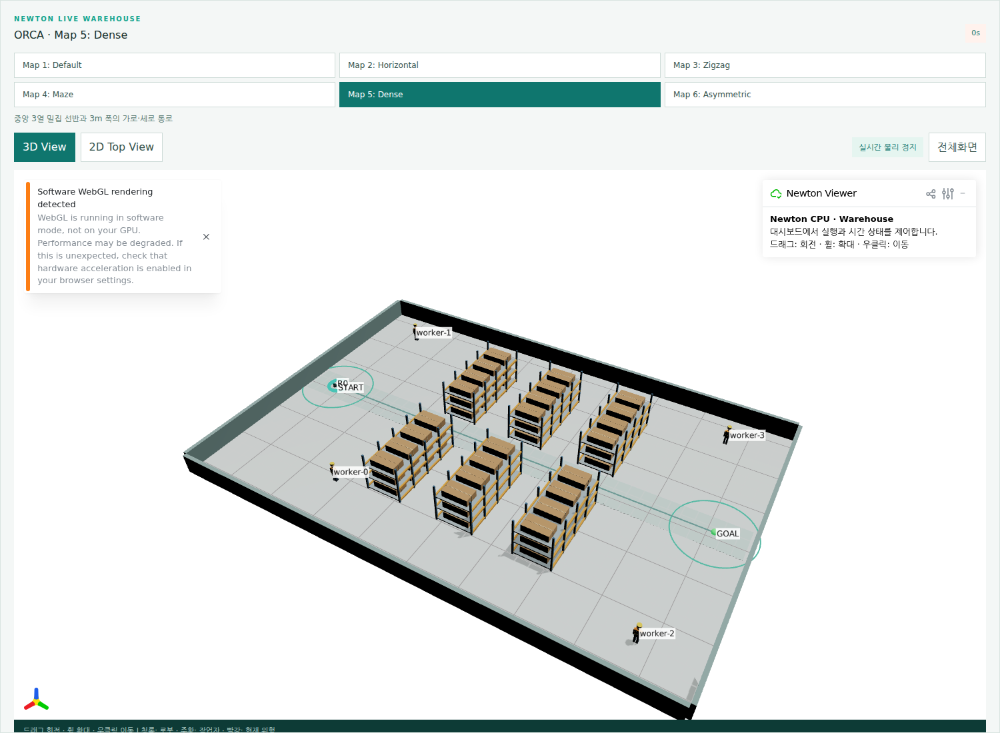
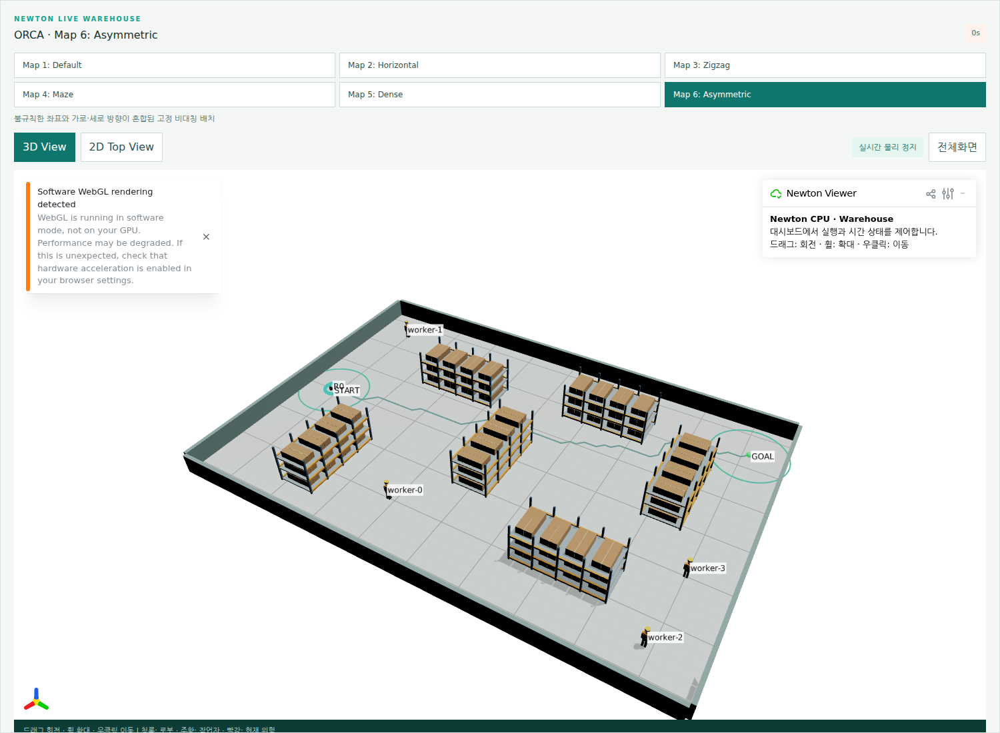

> 이전 버전 검증 기록입니다. 현재 Map6은 Fishbone이며, 공통 START/GOAL 및 성능 비교는 [최신 보고서](planning-study/README.md)를 참조하십시오.

# Newton 다중 선반 맵 검증 (2026-11-16)

## 실제 연결 구조

Angular 18의 `page.algorithm.run/view.ts` → WIZ `live_newton` → 독립 Python 3.12 worker → Newton 1.7.0 / Warp 1.19.0 CPU / XPBD 순서다. 기존 A*가 전역 경로를 만들고 Naive·VO·ORCA가 목표 속도를 반환한다. 공통 힘/토크 제어기가 실제 강체를 움직이며 `body_q`, `body_qd`, `Contacts`가 웹과 Viser에 전달된다. 다른 작업자/로봇은 기존의 비협조 왕복 순찰을 유지한다.

## 맵별 배치

38×26m 바닥·외벽, 3×7×3.2m 선반 6개와 기존 적재 박스 모델은 유지한다. 위치는 중심 좌표(m), 회전은 Z축 각도(degree)다.

| 맵 | 배치 | START → GOAL |
|---|---|---|
| 1 Default | 기존 상·하단 각 3개, 중앙 6m 직선 통로 | (2.5,13) → (35.5,13) |
| 2 Horizontal | 6개 모두 90도, 중앙 가로 선반 위·아래로 우회 | (2.5,13) → (35.5,13) |
| 3 Zigzag | 세 열의 3m 선반 틈을 위·아래로 번갈아 배치 | (2.5,11.5) → (35.5,11.5) |
| 4 Maze | 가로·세로 혼합, U자 막다른 길과 외곽 갈림길 | (2.5,7.5) → (35.5,20) |
| 5 Dense | 중앙 3열, 가로·세로 통로 3m | (2.5,13.5) → (35.5,13.5) |
| 6 Asymmetric | 비규칙 중심 좌표와 0/90도 회전 혼합 | (2.5,13) → (35.5,22.5) |

`warehouse_maps.json`에 요구된 mapId/mapName/description/shelfPositions/shelfRotations/startPosition/goalPosition/robotSpawnPosition/workerSpawnPositions와 순찰 목적지를 저장한다. 추가 맵도 같은 스키마로 확장하며, 현재 내비게이션은 정확한 직사각형 대응을 위해 90도 단위 회전을 지원한다. 무작위 선반 생성은 구현하지 않았다.

## 전환과 기존 기능

여섯 버튼 중 하나를 누르면 기존 worker에 Pause → Close를 순서대로 전달한다. iframe과 기록·경로를 비우고 새 맵의 강체·충돌체·A*를 생성한 뒤 시간 0에서 정지한다. Start/Resume으로 출발한다. 전환 중 버튼을 잠그며 이전 polling 응답은 세대 번호로 무시한다. 페이지 새로고침은 없다.

선반 모델에는 로컬 3×7m 메시와 회전을 적용하고, Newton box collider에도 같은 중심과 회전을 적용한다. A*와 2D는 동일한 회전 후 footprint를 사용한다. A*는 기존 격자 탐색을 유지하며 로봇 반경 + 설정 안전거리로 장애물을 확장한다. 대각선 이동이 장애물 모서리를 자르는 경우를 차단했다. 기존 기록은 shelf_poses가 없으면 기존 축 정렬 형상으로 표시한다.

비교 API도 선택 map_id를 전달한다. 결과에는 맵 이름·기하·시작/목표·경로·프레임을 저장하므로 다른 맵에서 얻은 결과를 재생해도 원래 환경을 복원한다. 24×16m 레거시 시나리오는 유지하고, 여섯 맵 버튼을 누르면 38×26m medium 환경으로 전환한다.

medium의 R0와 worker-0~3을 모두 유지했다. 작업자는 각 맵의 유효한 초기 위치와 장애물을 가로지르지 않는 왕복 순찰 구간을 사용한다. 추가 인원은 시드 기반으로 분산한다. 기존 회피 알고리즘은 변경하지 않았다.

## 검증 근거

- 새 pytest 48개, 기존 프로젝트 pytest 45개 통과 (총 93개). 경로/선반 비중첩/안전거리 0·0.35·1m/추가 인원/대체 경로/6개 맵 실제 Newton collider와 Viser 메시 pose 일치를 검사했다.
- seed 42, medium, R0 1대 + 작업자 4명, 1.2m/s, 안전거리 0.35m, 최대 3600frame에서 6맵 × 3알고리즘 총 18조건을 실제 CPU 실행했다. 모두 목표 거리 0.25m 이하, 정지 속도 0.02m/s 이하로 success. 충돌 집계 0, R0 Contacts는 ground만 기록했다. [실행 요약 JSON](map-physics-results.json).
- 기본 맵 ORCA에서 안전거리 위반 1회가 기록되었다. 물리 접촉이 없어도 안전거리 보장이 항상 성립하는 것은 아니다.
- 실제 Chromium/SwiftShader에서 6개 Viser 장면 렌더링, 2D/3D 전환, 8회 맵 반복 전환, 경로 초기화, R0/worker-0~3 유지, Resume 시간 증가, 새 iframe 1개, main frame 재탐색 0회와 브라우저 오류 0건을 확인했다. [브라우저 결과](map-browser-results.json).
- 별도 브라우저 검사에서 Map 6 선택이 세 알고리즘 비교 API에 전달되고, VO 기록을 열었을 때 원래 shelf_poses와 A* 경로가 복원되며 Reset이 시간 0/물리 정지로 돌아오는 것을 확인했다.
- WIZ 일반 빌드 성공. 배포·게시·보안 정책 변경은 하지 않았다.
- 최초 브라우저 테스트는 프레임 delta와 초기 라우팅을 전체 프레임/맵 새로고침으로 잘못 판정했다. 테스트 조건을 실제 API와 초기 진입에 맞게 수정한 후 통과했다. 최초 밀집 맵 Naive 실행에서 선반 Contacts가 확인되어 횡단 작업자를 선반 앞 개방 공간으로 옮긴 뒤 세 알고리즘 모두 선반 접촉이 없음을 재검증했다.

실행:
```bash
cd warehouse-collision-avoidance
.venv/bin/python newton_warehouse.py --scenario medium --map map4 --algorithm orca --frames 3600 --viewer null
.venv/bin/python -m pytest tests
# Playwright와 Chromium이 설치된 환경:
WAREHOUSE_CHROMIUM=/path/to/chromium python tests/browser_shelf_maps.py
```

## 실제 Viewer 캡처

| 1 | 2 | 3 |
|---|---|---|
|  |  |  |
|  |  |  |

## 제한

모든 시드·속도·인원 조합의 무충돌 보장은 검증하지 않았다. 작업자끼리 또는 추가 로봇끼리의 상호 회피는 기존과 같이 없다. 외부 RVO2나 장애물 ORCA 제약으로 교체하지 않았다. START/GOAL 수동 편집 UI는 기존에 없어 추가하지 않았으며 JSON으로 지정하고 유효성을 검사한다. GPU 성능은 검증하지 않았다. 브라우저 캡처는 실제 Viser의 소프트웨어 WebGL 렌더링이다.
